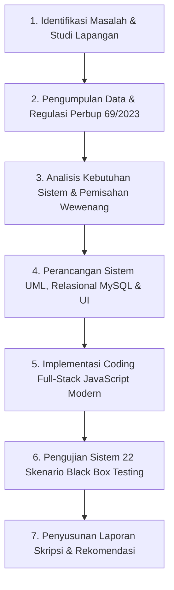
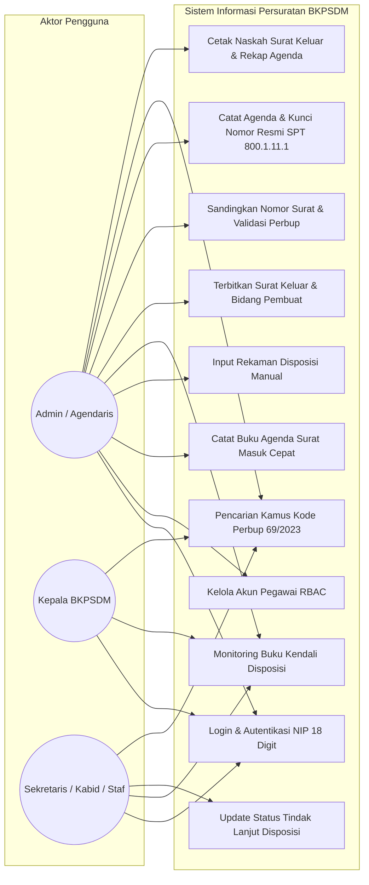
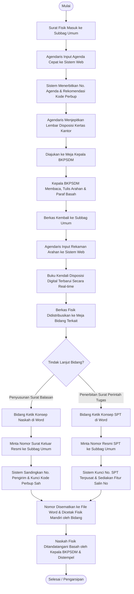

# PROPOSAL SKRIPSI
# BAB III METODOLOGI PENELITIAN (REVISI LENGKAP & DISESUAIKAN)

**Judul Penelitian:**  
*Pengembangan Sistem Informasi Persuratan Berbasis Web pada BKPSDM Kabupaten Luwu Timur Menggunakan Metode Waterfall*

**Penyusun:**  
**Yusri Mahendra** (NIM: IK2311011)  
Program Studi Sarjana Informatika, Fakultas Ilmu Komputer, Universitas Mega Buana Palopo (2026)

**Pembimbing I:** Ir. JUSTAM, S.Kom., M.Kom. (NIDN: 0925078504)  
**Pembimbing II:** NUR JAMILA, S.Kom., M.Kom. (NIDN: 1402058801)

---

## 3.1 Metode Penelitian

### 3.1.1 Pendekatan Penelitian
Pendekatan penelitian yang digunakan dalam penelitian berjudul **“Pengembangan Sistem Informasi Persuratan Berbasis Web pada BKPSDM Kabupaten Luwu Timur Menggunakan Metode Waterfall”** adalah pendekatan penelitian dan pengembangan (*Research and Development* / R&D) dengan memedomani model proses rekayasa perangkat lunak sekuensial linier (**Waterfall Model**).

Penelitian ini bertujuan untuk menghasilkan produk perangkat lunak berupa sistem tata kelola persuratan kedinasan berbasis web yang presisi, adaptif terhadap kultur kerja instansi, serta mematuhi regulasi kearsipan resmi daerah, yaitu **Peraturan Bupati Luwu Timur Nomor 69 Tahun 2023 tentang Kode Klasifikasi Arsip di Lingkungan Pemerintah Daerah** (turunan dari Permendagri Nomor 83 Tahun 2022). Fokus utama sistem diarahkan pada klasifikasi **800 (Kepegawaian)** yang merupakan tugas pokok dan fungsi (tupoksi) utama Badan Kepegawaian dan Pengembangan Sumber Daya Manusia (BKPSDM) Kabupaten Luwu Timur, dengan tetap mengintegrasikan rumpun urusan pemerintahan daerah lainnya (`000` s/d `900`).

Pengumpulan data dalam pendekatan R&D ini dilakukan melalui teknik triangulasi:
1. **Observasi Partisipatif:** Mengamati secara langsung alur persuratan fisik, tata cara registrasi buku agenda besar, dan mekanisme penyerahan lembar disposisi kertas dinas ke ruang Kepala Badan.
2. **Wawancara Mendalam (*In-depth Interview*):** Berdialog langsung dengan Kepala BKPSDM (*PARHA ARIEF, S.AP*), agendaris Subbagian Umum, serta para Kepala Bidang teknis mengenai kendala penomoran ganda, keterlambatan disposisi, dan keraguan penentuan kode klasifikasi arsip.
3. **Studi Dokumentasi & Regulasi:** Mengkaji berkas fisik buku agenda surat, format blanko resmi disposisi Pemkab Luwu Timur, serta mengodekan 2.961 entri naskah Perbup Luwu Timur No. 69 Tahun 2023 ke dalam basis data sistem.

Model pengembangan sistem **Waterfall** diterapkan secara berurutan (*sequential steps*) melalui 5 tahapan utama:
1. **Analisis Kebutuhan (*Requirements Analysis*):** Mengidentifikasi permasalahan alur administrasi kantor, batasan tanggung jawab antar-bidang, kebutuhan penanganan surat rahasia (seperti izin perceraian ASN kode `800.1.8.1`), dan spesifikasi fungsional sistem.
2. **Perancangan Sistem (*System Design*):** Merancang arsitektur basis data relasional MySQL (7 tabel terhubung), pemodelan UML (*Use Case Diagram, Activity Diagram, Sequence Diagram*), dan desain antarmuka berbasis *Clean Government Modern UI*.
3. **Implementasi (*Implementation / Coding*):** Mengembangkan sistem menggunakan arsitektur *Full-stack JavaScript Modern* yang mendukung pencarian *in-memory* berlatensi sangat rendah (< 15 milidetik) untuk 2.961 entri klasifikasi.
4. **Pengujian Sistem (*System Testing*):** Memvalidasi seluruh fungsi sistem menggunakan metode **Black Box Testing** melalui 22 skenario kasus uji komprehensif.
5. **Pemeliharaan & Keberlanjutan (*Maintenance & Data Integrity*):** Menyediakan mekanisme pencadangan (*backup*) data otomatis ke dalam skrip relasional ANSI/MySQL standar (`database_persuratan.sql`).

---

### 3.1.2 Jenis Penelitian
Jenis penelitian ini adalah **penelitian dan pengembangan (*Research and Development* / R&D)** di bidang Rekayasa Perangkat Lunak (*Software Engineering*). Menurut Sugiyono (2019), metode penelitian dan pengembangan adalah metode penelitian yang digunakan untuk menghasilkan produk tertentu dan menguji keefektifan produk tersebut.

Produk yang dihasilkan dari penelitian ini adalah **Sistem Informasi Persuratan Berbasis Web pada BKPSDM Kabupaten Luwu Timur** yang memiliki kebaruan fungsional:
1. *Smart Auto-Suggest Engine* penentu kode klasifikasi arsip daerah berdasarkan perihal surat secara instan.
2. *Lembar Kartu Kendali Penyandingan Nomor (Pairing System)* antara nomor surat asal instansi pengirim dengan nomor surat keluar resmi BKPSDM.
3. *Buku Kendali Disposisi Digital* untuk merekam instruksi manual tulisan tangan dan paraf basah Kepala BKPSDM.
4. *Buku Agenda & Penomoran Resmi Surat Perintah Tugas (SPT) Terpusat* guna mencegah terjadinya nomor ganda/loncat antar-bidang.

---

## 3.2 Tahapan Penelitian

Tahapan penelitian dilaksanakan secara sistematis mengikuti tahapan SDLC Waterfall yang dipadukan dengan siklus penelitian terapan:



### Rincian Pelaksanaan Setiap Tahapan:
1. **Identifikasi Masalah:** Menemukan fakta bahwa pengelolaan persuratan masih mengandalkan pencatatan buku tulis fisik bergaris, hilangnya jejak tindak lanjut disposisi pimpinan (*untracked disposition*), tingginya salah kodifikasi surat keluar akibat staf hanya menyalin nomor pengirim luar, serta risiko nomor ganda pada penerbitan Surat Perintah Tugas (SPT).
2. **Pengumpulan Data:** Mengumpulkan data primer dari observasi Subbagian Umum dan Kepegawaian, wawancara pejabat, serta data sekunder berupa file digital Perbup Luwu Timur No. 69 Tahun 2023 sebanyak 2.961 entri kode klasifikasi kearsipan.
3. **Analisis Kebutuhan Sistem:** Merumuskan 12 kebutuhan fungsional dan kebutuhan non-fungsional, serta menegaskan batas wewenang kerja: bidang teknis menyusun naskah fisik di pengolah kata (*Word*) dan mencetak mandiri, sedangkan Bagian Umum bertindak sebagai otoritas pengunci nomor resmi digital terpusat (*Centralized Digital Numbering*).
4. **Perancangan Sistem (*Design*):**
   - Pemodelan fungsional: Use Case Diagram, Activity Diagram, dan Sequence Diagram.
   - Pemodelan basis data: Perancangan Entity Relationship Diagram (ERD) dan skema 7 tabel relasional MySQL (`pegawai`, `klasifikasi_arsip`, `surat_masuk`, `disposisi`, `surat_keluar`, `surat_tugas`, `surat_tugas_personil`).
   - Perancangan antarmuka: Dashboard statistik, form registrasi cepat surat masuk, modal pencatatan disposisi, kartu kendali penyandingan nomor, dan buku agenda SPT.
5. **Implementasi (*Coding*):** Mengembangkan perangkat lunak dengan pendekatan modular JavaScript, mengintegrasikan master data 2.961 kode klasifikasi daerah, membangun algoritma *fuzzy search auto-suggest*, serta mengamankan otentikasi NIP aparatur.
6. **Pengujian Sistem (*Testing*):** Melakukan pengujian fungsionalitas kotak hitam (*Black Box Testing*) dengan 22 kasus uji untuk memastikan tidak terjadi galat (*zero-defect*).
7. **Penyusunan Laporan:** Mendokumentasikan hasil penelitian ke dalam naskah skripsi lengkap, artikel ilmiah, dan panduan operasional sistem.

---

## 3.3 Tempat dan Waktu Penelitian

### 3.3.1 Tempat Penelitian
Penelitian ini dilaksanakan di **Badan Kepegawaian dan Pengembangan Sumber Daya Manusia (BKPSDM) Kabupaten Luwu Timur**, yang berlokasi di Kompleks Perkantoran Pemerintah Daerah Kabupaten Luwu Timur, Provinsi Sulawesi Selatan. 

Pemilihan lokasi penelitian didasarkan pada pertimbangan:
1. BKPSDM merupakan instansi sentral pengelola manajemen kepegawaian aparatur sipil negara (ASN) se-Kabupaten Luwu Timur yang memiliki volume korespondensi surat masuk, surat keluar, disposisi, dan surat tugas kedinasan yang sangat padat.
2. Diberlakukannya Perbup Luwu Timur No. 69 Tahun 2023 menuntut ketertiban tata naskah dinas dan kodifikasi kearsipan daerah yang belum terfasilitasi secara optimal oleh pencatatan manual.

### 3.3.2 Waktu Penelitian
Waktu penelitian dilaksanakan selama 3 (tiga) bulan, terhitung mulai bulan Mei 2026 sampai dengan Juli 2026 dengan rincian jadwal sebagai berikut:

**Tabel 3.0 Jadwal Kegiatan Penelitian**
| No | Rincian Kegiatan | Mei 2026 | Juni 2026 | Juli 2026 |
| :---: | :--- | :---: | :---: | :---: |
| 1 | Observasi Lapangan & Identifikasi Masalah | Minggu 1-2 | - | - |
| 2 | Wawancara & Pengumpulan Regulasi Perbup 69/2023 | Minggu 3-4 | - | - |
| 3 | Analisis Kebutuhan Sistem & Pemodelan UML | - | Minggu 1 | - |
| 4 | Perancangan Basis Data Relasional & UI Mockup | - | Minggu 2 | - |
| 5 | Implementasi Coding Program & Mesin Auto-Suggest | - | Minggu 3-4 | Minggu 1 |
| 6 | Pengujian Black Box Testing (22 Kasus Uji) | - | - | Minggu 2 |
| 7 | Penyusunan Laporan Hasil & Ujian Sidang Skripsi | - | - | Minggu 3-4 |

---

## 3.4 Analisis Kebutuhan Sistem

### 3.4.1 Kebutuhan Fungsional (*Functional Requirements*)
Kebutuhan fungsional mendefinisikan kapabilitas, proses bisnis, dan layanan interaktif yang wajib disediakan oleh sistem informasi persuratan:

**Tabel 3.1 Kebutuhan Fungsional Sistem Baru BKPSDM**
| No | Kebutuhan Fungsional | Deskripsi Fungsionalitas |
| :---: | :--- | :--- |
| **1** | **Autentikasi NIP Resmi 18 Digit** | Sistem mengautentikasi pengguna menggunakan Nomor Induk Pegawai (NIP) resmi 18 digit dan kata sandi terenkripsi, dilengkapi simulasi akses cepat (*1-click quick access*) untuk kebutuhan demonstrasi sidang skripsi. |
| **2** | **Pengelolaan Akun & Hak Akses Berjenjang (RBAC)** | Sistem menyediakan manajemen peran pengguna ke dalam 5 tingkatan wewenang kedinasan: Administrator/Agendaris, Kepala BKPSDM, Sekretaris Badan, Kepala Bidang, dan Staf Pelaksana. |
| **3** | **Pencatatan Cepat Buku Agenda Surat Masuk** | Sistem mencatat nomor registrasi agenda otomatis, nomor surat asal pengirim, instansi pengirim, perihal ringkas, tanggal surat, tanggal diterima, sifat surat, dan klasifikasi internal BKPSDM secara cepat tanpa membebani petugas dengan pemindaian lampiran berkas fisik yang diedarkan manual bersama lembar disposisi. |
| **4** | **Perekaman Buku Kendali Disposisi Manual Pimpinan** | Sesuai kondisi riil di mana lembar fisik disposisi telah dicetak resmi oleh kantor dan arahan ditulis tangan serta diparaf basah oleh Kepala BKPSDM (*PARHA ARIEF, S.AP*), sistem berfungsi mencatat ringkasan instruksi tulisan tangan tersebut ke dalam buku kendali digital agar status penanganan (*Menunggu / Didisposisi / Selesai*) terpantau *real-time*. |
| **5** | **Penerbitan Surat Keluar Mandiri & Nomor Otomatis** | Sistem menerbitkan nomor surat keluar resmi format kedinasan `[KODE]/[URUT]/BKPSDM/[ROMAWI]/[TAHUN]` dan mencatat identitas bidang pembuat naskah (`bidang_pembuat`) guna menjamin ketertiban registrasi. |
| **6** | **Penyandingan Nomor (*Pairing*) & Validasi Kode Perbup yang Benar** | Pada pembuatan surat balasan, sistem menyandingkan secara eksplisit nomor surat masuk asal pengirim dengan nomor keluar resmi BKPSDM, sekaligus mengunci kode klasifikasi yang sah memedomani Perbup Luwu Timur No. 69 Tahun 2023. |
| **7** | **Mesin Rekomendasi Pintar (*Smart Auto-Suggest Engine*)** | Saat staf mengetik perihal surat pada formulir, sistem secara otomatis mencocokkan kata kunci ke kamus 2.961 kode klasifikasi arsip daerah dan menyajikan rekomendasi kode tercepat dalam waktu < 15 milidetik. |
| **8** | **Buku Agenda & Penomoran Resmi SPT Terpusat (Kode 800.1.11.1)** | Sistem menyediakan buku agenda khusus penomoran Surat Perintah Tugas (SPT) multi-aparatur terpusat untuk mencegah nomor ganda/loncat antar-bidang, mencatat personil pelaksana, maksud tugas, tanggal, lokasi tujuan, dan tombol cepat salin nomor (*copy-to-clipboard*). Naskah fisik SPT dicetak mandiri oleh bidang pengusul. |
| **9** | **Penanganan Dokumen Rahasia (Disiplin & Perceraian ASN)** | Sistem mendeteksi otomatis kode klasifikasi rahasia (seperti `800.1.8.1` Izin Perceraian ASN dan `800.1.6.2` Hukuman Disiplin Pegawai), mengunci sifat menjadi rahasia, serta menetapkan perlakuan naskah bersampul segel tertutup di brankas arsip kepegawaian. |
| **10** | **Kamus Master Kode Klasifikasi Arsip Daerah (2.961 Kode)** | Sistem menyediakan antarmuka pencarian cepat seluruh regulasi kode klasifikasi kearsipan daerah Kabupaten Luwu Timur yang terbagi ke dalam 10 tab urusan pemerintahan (`000` s/d `900`). |
| **11** | **Rekapitulasi Agenda & Cetak Laporan** | Sistem menyajikan rekapitulasi agenda surat masuk, keluar, disposisi, dan SPT berdasarkan rentang tanggal dan status untuk keperluan pelaporan resmi ke pimpinan. |
| **12** | **Keamanan Profil & Perubahan Kata Sandi Mandiri** | Aparatur dapat memperbarui kata sandi akun secara mandiri melalui modal profil pengguna. |

---

### 3.4.2 Kebutuhan Non-Fungsional (*Non-Functional Requirements*)
Kebutuhan non-fungsional mencakup batasan operasional, performa, dan keandalan sistem:

**Tabel 3.2 Kebutuhan Perangkat Keras Minimum (*Hardware*)**
| No | Perangkat Keras | Spesifikasi Minimum Rekomendasi | Fungsi dalam Sistem |
| :---: | :--- | :--- | :--- |
| 1 | Processor | Intel Core i3 Generasi ke-6 / AMD Ryzen 3 (Quad Core 2.0 GHz) | Pemrosesan instruksi server dan komputasi *in-memory* |
| 2 | Memori (RAM) | 4 GB DDR4 (Disarankan 8 GB) | Menampung cache master data 2.961 kode klasifikasi |
| 3 | Media Penyimpanan | SSD 128 GB / HDD 500 GB | Menyimpan source code aplikasi dan data persuratan |
| 4 | Monitor | Layar 14 Inci dengan Resolusi HD (1366 x 768) | Penampilan antarmuka dashboard dan kartu kendali persuratan |
| 5 | Perangkat Input | Keyboard QWERTY dan Mouse Optik | Penginputan data agenda persuratan |
| 6 | Jaringan | Kartu Jaringan LAN / Wi-Fi Adapter 802.11 b/g/n | Komunikasi data pada jaringan lokal intranet kantor BKPSDM |

**Tabel 3.3 Kebutuhan Perangkat Lunak (*Software Environment*)**
| No | Perangkat Lunak | Komponen / Versi | Fungsi / Alasan Ilmiah Pemilihan |
| :---: | :--- | :--- | :--- |
| 1 | Sistem Operasi | Microsoft Windows 10 / 11 (64-bit) | Lingkungan operasional server dan klien di kantor BKPSDM |
| 2 | Runtime Lingkungan | Node.js Runtime (v18+ / v22 LTS) | Menjalankan *event-driven non-blocking I/O web server* |
| 3 | Arsitektur Bahasa | Full-stack JavaScript (HTML5, Modern CSS, Vanilla JS) | Menghilangkan jeda *page reload*; latensi pencarian 2.961 kode Perbup < 15 ms |
| 4 | Basis Data Relasional | MySQL Server / SQL Script ANSI (`database_persuratan.sql`) | Menjamin integritas relasional 7 tabel dan portabilitas data |
| 5 | Peramban Web | Google Chrome / Microsoft Edge / Mozilla Firefox | Antarmuka pengguna (*client browser*) |
| 6 | Editor Kode Program | Visual Studio Code | Penulisan dan pemeliharaan kode sumber aplikasi |

**Tabel 3.4 Matriks Hak Akses Pengguna Berjenjang (*Role-Based Access Control*)**
| Modul / Hak Akses | Admin Agendaris (Subbag Umum) | Kepala BKPSDM (Pimpinan) | Sekretaris Badan | Kepala Bidang Teknis | Staf Pelaksana |
| :--- | :---: | :---: | :---: | :---: | :---: |
| Manajemen Pegawai & Akun | Full Access | Read-Only | Read-Only | Read-Only | No Access |
| Input Buku Agenda Surat Masuk | Full Access | Read-Only | Read-Only | Read-Only | Read-Only |
| Input Rekaman Disposisi Manual | Full Access | Read / Validasi | Read-Only | Read-Only | No Access |
| Monitoring Buku Kendali Disposisi | Full Access | Full Access | Full Access | Full Access | Read-Only (Tugasnya) |
| Update Status Tindak Lanjut | Full Access | No Access | Full Access | Full Access | Full Access |
| Registrasi Nomor Surat Keluar | Full Access | Read-Only | Read-Only | Minta Nomor | No Access |
| Kartu Kendali Penyandingan Nomor | Full Access | Read-Only | Read-Only | Read-Only | No Access |
| Registrasi & Salin Nomor SPT | Full Access | Read-Only | Read-Only | Minta / Salin | Read-Only |
| Kamus Master Perbup 69/2023 | Full Access | Full Access | Full Access | Full Access | Full Access |
| Rekapitulasi & Cetak Laporan | Full Access | Full Access | Full Access | Read-Only | No Access |

---

## 3.5 Metode Pengumpulan Data

Pengumpulan data dalam penelitian ini dilakukan melalui 4 instrumen terpadu:
1. **Observasi Langsung:** Dilakukan di ruang Subbagian Umum dan Kepegawaian BKPSDM Kabupaten Luwu Timur. Peneliti mengamati prosedur pencatatan surat masuk pada buku agenda besar, format cap stempel registrasi, peletakan berkas fisik pada map disposisi kuning, serta alur penomoran surat keluar dan penugasan perjalanan dinas.
2. **Wawancara Terstruktur:** Dilakukan kepada:
   - Kepala BKPSDM (*PARHA ARIEF, S.AP*) mengenai alur disposisi fisik pimpinan dan pentingnya buku kendali digital pemonitor tindak lanjut.
   - Kasubag Umum dan Staf Agendaris mengenai kendala penetapan kode klasifikasi arsip daerah dan risiko nomor ganda antar-bidang.
   - Kepala Bidang Pengadaan, Mutasi, dan Informasi Kepegawaian mengenai pembuatan konsep naskah mandiri di Microsoft Word dan penanganan surat rahasia ASN.
3. **Studi Dokumentasi:** Mengumpulkan contoh dokumen asli: lembar disposisi cetak kantor BKPSDM, buku register agenda masuk/keluar, salinan Surat Perintah Tugas (SPT), naskah balasan surat dinas, serta dokumen digital **Peraturan Bupati Luwu Timur Nomor 69 Tahun 2023**.
4. **Studi Kepustakaan (*Literature Review*):** Mempelajari referensi ilmiah terkait teori metode Waterfall (Pressman, 2015; Sommerville, 2011), tata kearsipan pemerintah daerah (Permendagri No. 83/2022), arsitektur web modern berbasis JavaScript, serta prinsip pengujian *Black Box Testing*.

---

## 3.6 Instrumen Penelitian dan Pengujian Sistem

Instrumen pengujian sistem disusun menggunakan pendekatan **Black Box Testing** (pengujian kotak hitam) yang mencakup 22 kasus uji fungsional:

**Tabel 3.5 Matriks 22 Kasus Uji Black Box Testing**
| No | Fitur / Kasus Uji | Skenario Pengujian | Hasil yang Diharapkan |
| :---: | :--- | :--- | :--- |
| 1 | Autentikasi Pengguna (Login) | Memasukkan NIP 18 digit dan kata sandi valid pada form login. | Sistem memvalidasi kredensial dan mengarahkan ke dashboard sesuai hak akses. |
| 2 | Akses Cepat Simulasi Sidang | Menekan salah satu tombol peran aparatur pada panel simulasi sidang. | Sistem login seketika sebagai peran terpilih tanpa perlu mengetik manual. |
| 3 | Keluar Sistem (Logout) | Menekan tombol "Keluar" pada bilah header dan mengonfirmasi. | Sesi pengguna berakhir dan antarmuka kembali ke halaman login resmi. |
| 4 | Pencatatan Surat Masuk Baru | Mengisi data identitas surat pengirim dan memilih kode kearsipan usulan. | Sistem mencatat agenda urut otomatis dengan status "Menunggu Disposisi". |
| 5 | Mesin Auto-Suggest Kode Perbup | Mengetik kata kunci perihal (misal: "Cuti", "Pangkat", "Disiplin") di formulir. | Rekomendasi kode klasifikasi dan hierarki Perbup 69/2023 tampil instan (< 15ms). |
| 6 | Pratinjau Berkas Digital A4 | Menekan tombol "Berkas" pada baris data surat masuk. | Lembar kerja naskah dinas format A4 tampil lengkap beserta tanda registrasi arsip. |
| 7 | Rekam Disposisi Manual Pimpinan | Menginput ringkasan arahan tulisan tangan dan paraf Kepala Badan dari lembar fisik. | Data rekaman instruksi tersimpan ke buku kendali dan status surat berubah "Didisposisi". |
| 8 | Monitoring Buku Kendali Disposisi | Membuka menu buku kendali disposisi untuk memantau arahan pimpinan. | Rekapitulasi disposisi tersaji terstruktur dan status tindak lanjut dapat dimonitor. |
| 9 | Pembuatan Surat Keluar Mandiri | Mengisi perihal surat keluar, memilih bidang pembuat, dan menetapkan kode arsip. | Sistem mengunci nomor keluar resmi format `[KODE]/[URUT]/BKPSDM/[ROMAWI]/[TAHUN]`. |
| 10 | Penyandingan Nomor (*Pairing*) | Memilih opsi "Ya, Balasan atas Surat Masuk" dan memilih surat masuk asal. | Nomor surat pengirim dan nomor keluar BKPSDM tersandingkan berdampingan. |
| 11 | Deteksi Berkas Rahasia | Memilih kode arsip rahasia (`800.1.6.2` Disiplin atau `800.1.8.1` Perceraian). | Sistem otomatis mengunci sifat "Rahasia" dan memberi tanda naskah beramplop segel. |
| 12 | Pratinjau Naskah Dinas Resmi A4 | Menekan tombol "Naskah" pada baris surat keluar. | Lembar dinas resmi format A4 tampil rapi lengkap dengan box rujukan penyandingan. |
| 13 | Registrasi Nomor Resmi SPT | Memilih bidang pengusul tugas, mengisi maksud tugas, aparatur, tanggal, lokasi. | Sistem mengunci nomor resmi SPT terpusat dan mencatat ke buku agenda dinas. |
| 14 | Penelusuran Kamus Perbup 69/2023 | Memilih tab filter urusan (`000` s/d `900`) atau mengetik pencarian kode. | Sistem memfilter 2.961 entri kode arsip resmi daerah Kabupaten Luwu Timur secara instan. |
| 15 | Rekapitulasi Buku Agenda & Laporan | Memfilter data berdasarkan rentang tanggal dan kategori naskah persuratan. | Laporan buku agenda terstruktur siap dicetak atau diunduh untuk pimpinan. |
| 16 | Manajemen Pengguna (Tambah Akun) | Mengisi formulir aparatur baru (NIP, nama, pangkat, jabatan, peran). | Sistem memvalidasi keunikan format NIP dan menambahkan akun ke tabel pegawai. |
| 17 | Manajemen Pengguna (Ubah & Hapus) | Mengubah data jabatan/peran aparatur atau menghapus akun simulasi. | Data pegawai berhasil diperbarui atau dihapus secara aman dari sistem. |
| 18 | Sinkronisasi Basis Data MySQL | Menjalankan mutasi data persuratan pada sistem web. | Perubahan otomatis tersinkronisasi ke file skrip SQL standar MySQL. |
| 19 | Fitur CRUD Persuratan Aman | Mengedit atau menghapus data surat masuk/keluar/disposisi yang keliru. | Data berhasil diperbarui atau dihapus setelah konfirmasi keamanan. |
| 20 | Pencatatan Cepat Tanpa Lampiran | Mengisi formulir surat masuk tanpa kewajiban unggah file berkas lampiran. | Data agenda tersimpan instan tanpa hambatan pemrosesan pemindaian berkas tebal. |
| 21 | Fitur Salin Nomor SPT ke Clipboard | Menekan tombol "Salin No" pada baris data agenda Surat Perintah Tugas. | String nomor resmi SPT tersalin ke clipboard sistem untuk disematkan ke file Word. |
| 22 | Pengubahan Kata Sandi Mandiri | Membuka modal profil pengguna, mengisi kata sandi lama dan baru. | Sistem memvalidasi kata sandi lama dan memperbarui kata sandi baru akun. |

---

## 3.7 Teknik Analisis Data

Teknik analisis data yang digunakan adalah **analisis deskriptif kualitatif dan analisis fungsional sistem**:
1. **Analisis Data Alur Berjalan (*As-Is Process*):** Menguraikan kelemahan alur manual pencatatan buku agenda fisik, risiko kehilangan riwayat disposisi kertas, keraguan agendaris dalam memilih kode Perbup, serta ketiadaan kontrol nomor ganda SPT.
2. **Analisis Kebutuhan Sistem Baru (*To-Be Process*):** Merancang alur persuratan hibrida yang mempertahankan keabsahan legalitas disposisi fisik pimpinan namun mempercepat kontrol melalui buku kendali digital, auto-suggest kode arsip, dan penomoran resmi terpusat.
3. **Analisis Validasi Pengujian (*Testing Analysis*):** Menghitung persentase keberhasilan pengujian *Black Box Testing* dengan rumus:
$$\text{Tingkat Kelayakan (\%)} = \left( \frac{\text{Jumlah Kasus Uji Valid}}{\text{Total Kasus Uji}} \right) \times 100\%$$
Target pengujian adalah mencapai tingkat kelayakan 100% valid untuk menjamin kesiapan implementasi sistem di lingkungan BKPSDM Kabupaten Luwu Timur.

---

## 3.8 Algoritma yang Digunakan

Sistem informasi persuratan ini mengimplementasikan 6 algoritma proses bisnis utama:

### 3.8.1 Algoritma Otentikasi Berbasis NIP dan Role-Based Access Control (RBAC)
```text
Langkah 1: Pengguna memasukkan NIP (18 digit) dan kata sandi pada formulir login.
Langkah 2: Sistem memeriksa format NIP menggunakan ekspresi reguler (regex 18 digit angka).
Langkah 3: Sistem mencari kecocokan NIP pada tabel data pegawai.
Langkah 4: Jika NIP ditemukan dan kata sandi valid:
           a. Bentuk objek sesi (NIP, nama, jabatan, unit kerja, peran akses).
           b. Tentukan batas hak akses menu berdasarkan peran (Admin/Kaban/Sekretaris/Kabid/Staf).
           c. Tampilkan halaman Dashboard sistem persuratan.
Langkah 5: Jika tidak cocok, tampilkan notifikasi kesalahan kredensial login.
```

### 3.8.2 Algoritma Pencatatan Cepat Surat Masuk Tanpa Beban Lampiran
```text
Langkah 1: Agendaris Subbag Umum menerima berkas surat fisik dari instansi luar.
Langkah 2: Agendaris membuka formulir tambah surat masuk di sistem informasi persuratan.
Langkah 3: Sistem secara otomatis menghasilkan Nomor Agenda Urut berikutnya (auto-increment tahunan).
Langkah 4: Agendaris menginput identitas pokok: Nomor Surat Asal Pengirim, Instansi Pengirim, Tanggal Surat, Perihal Ringkas, dan Sifat Surat.
Langkah 5: Sistem menjalankan auto-suggest untuk memberikan rekomendasi kode klasifikasi kearsipan internal BKPSDM memedomani Perbup 69/2023.
Langkah 6: Simpan record ke tabel `surat_masuk` dengan status awal "Menunggu Disposisi".
Langkah 7: Agendaris menjepitkan lembar fisik disposisi kantor ke berkas asli untuk diajukan ke meja Kepala BKPSDM.
```

### 3.8.3 Algoritma Mesin Rekomendasi Pintar (*Smart Auto-Suggest Engine*) Kode Perbup 69/2023
```text
Langkah 1: Pengguna mengetikkan string perihal surat pada kolom input (contoh: "usulan pensiun bup").
Langkah 2: Sistem menangkap event ketukan keyboard (`oninput`) dan melakukan tokenisasi string menjadi kata-kata kunci lowercase.
Langkah 3: Sistem memfilter koleksi 2.961 entri master kode klasifikasi Perbup 69/2023 secara in-memory:
           Untuk setiap entri kode:
           Hitung skor kecocokan antara token pencarian dengan atribut `nama`, `kode`, `kategori`, dan `kata_kunci`.
Langkah 4: Urutkan hasil pencarian berdasarkan relevansi tertinggi (prioritas klaster 800 Kepegawaian untuk tupoksi BKPSDM, namun tetap menyajikan klaster 000 s/d 900 jika kata kunci relevan).
Langkah 5: Render maksimal 10 rekomendasi kode terbaik ke dropdown antarmuka dalam waktu < 15 milidetik.
Langkah 6: Saat pengguna mengklik salah satu rekomendasi, kolom kode klasifikasi dan deskripsi terisi otomatis.
```

### 3.8.4 Algoritma Perekaman Buku Kendali Disposisi Manual Pimpinan
```text
Langkah 1: Berkas fisik yang telah ditandatangani dan diparaf basah oleh Kepala BKPSDM dikembalikan ke Subbag Umum.
Langkah 2: Agendaris membuka menu "Catat Disposisi" pada nomor agenda surat masuk bersangkutan.
Langkah 3: Agendaris mencentang instruksi pimpinan sesuai lembar fisik (misal: Tindak lanjuti, Pelajari/Telaah, Koordinasikan).
Langkah 4: Agendaris memilih Pejabat Struktural Penerima Disposisi (Sekretaris atau Kepala Bidang terkait).
Langkah 5: Agendaris menyalin catatan khusus instruksi pimpinan dan menetapkan batas waktu tindak lanjut.
Langkah 6: Simpan data ke tabel `disposisi`, dan perbarui status di tabel `surat_masuk` menjadi "Didisposisi".
Langkah 7: Pejabat struktural tujuan menerima pembaruan pada Buku Kendali Disposisi digital di layar masing-masing secara real-time.
```

### 3.8.5 Algoritma Penyandingan Nomor Surat Keluar Balasan (*Pairing System*)
```text
Langkah 1: Bidang teknis mengajukan permintaan nomor surat keluar balasan ke Subbag Umum.
Langkah 2: Agendaris membuka formulir surat keluar dan memilih opsi "Ya, Balasan atas Surat Masuk".
Langkah 3: Sistem menyajikan daftar surat masuk yang telah didisposisikan. Agendaris memilih surat masuk asal.
Langkah 4: Sistem menarik otomatis Nomor Surat Pengirim Asal dan Instansi Pengirim ke naskah rujukan.
Langkah 5: Agendaris memilih Bidang Pembuat Naskah (`bidang_pembuat`) dan menetapkan Kode Klasifikasi Arsip yang benar memedomani Perbup 69/2023.
Langkah 6: Sistem mengunci nomor surat resmi keluar BKPSDM format: `[KODE_BENAR]/[URUT]/BKPSDM/[ROMAWI]/[TAHUN]`.
Langkah 7: Sistem menyandingkan Nomor Pengirim Asal dengan Nomor Keluar Resmi BKPSDM pada Kartu Kendali Penyandingan dan naskah dinas resmi.
```

### 3.8.6 Algoritma Registrasi & Penomoran Resmi SPT Terpusat (*Copy-to-Clipboard*)
```text
Langkah 1: Bidang teknis menyusun konsep perjalanan dinas dan meminta nomor resmi SPT ke Subbag Umum.
Langkah 2: Agendaris membuka menu Surat Perintah Tugas (SPT) dan menekan "Catat & Ambil Nomor SPT".
Langkah 3: Agendaris memilih Bidang Pengusul Penugasan, menginput maksud perjalanan dinas, lokasi tujuan, dan rentang tanggal tugas.
Langkah 4: Agendaris memilih personil aparatur yang ditugaskan (multi-pegawai) dari database pegawai.
Langkah 5: Sistem mengunci nomor resmi SPT terpusat kode `800.1.11.1/[URUT]/BKPSDM/[ROMAWI]/[TAHUN]`.
Langkah 6: Simpan record ke tabel `surat_tugas` dan `surat_tugas_personil`.
Langkah 7: Agendaris atau staf bidang menekan tombol "Salin No" untuk menyalin string nomor resmi ke papan klip (*clipboard*), lalu menempelkannya ke dokumen Microsoft Word naskah fisik SPT untuk dicetak dan diajukan tanda tangan basah ke Kepala BKPSDM.
```

---

## 3.9 Rancangan Sistem Baru

### 3.9.1 Pemodelan Use Case Diagram
Arsitektur interaksi pengguna dengan sistem persuratan dimodelkan melalui diagram use case dengan memisahkan wewenang antara Subbagian Umum (Agendaris), Pimpinan (Kepala BKPSDM), dan Pejabat Struktural (Sekretaris / Kepala Bidang / Staf):



### 3.9.2 Diagram Alir (*Flowchart*) Persuratan Terintegrasi



---

## 3.10 Rangkuman Bab III

Bab III ini menguraikan metodologi penelitian rekayasa perangkat lunak menggunakan model Waterfall yang diterapkan secara disiplin dan bertahap untuk mengembangkan Sistem Informasi Persuratan Berbasis Web pada BKPSDM Kabupaten Luwu Timur. Berbeda dengan rancangan proposal awal konvensional, metodologi penelitian ini telah disempurnakan dan disesuaikan 100% dengan realitas tata naskah kedinasan daerah:
1. Mengintegrasikan **Perbup Luwu Timur Nomor 69 Tahun 2023** (2.961 master kode klasifikasi arsip daerah) ke dalam mesin rekomendasi pintar (*smart auto-suggest*).
2. Mengakomodir **Buku Kendali Disposisi Digital** untuk merekam arahan tulisan tangan dan paraf basah Kepala BKPSDM tanpa mengubah stok lembaran disposisi fisik kantor.
3. Menegaskan batas tanggung jawab organisasi (*division of responsibility*): bidang teknis menyusun dan mencetak fisik naskah dinas/SPT mandiri di pengolah kata, sedangkan Subbag Umum mengunci penomoran resmi digital terpusat (*centralized digital numbering*) guna mencegah nomor ganda/loncat.
4. Menerapkan pengujian sistem berbasis **Black Box Testing dengan 22 kasus uji** untuk menjamin fungsionalitas sistem berjalan bebas galat sebelum diimplementasikan.
