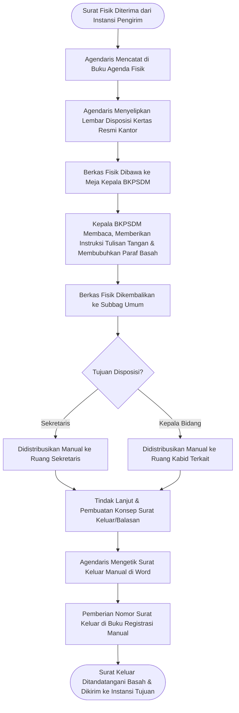
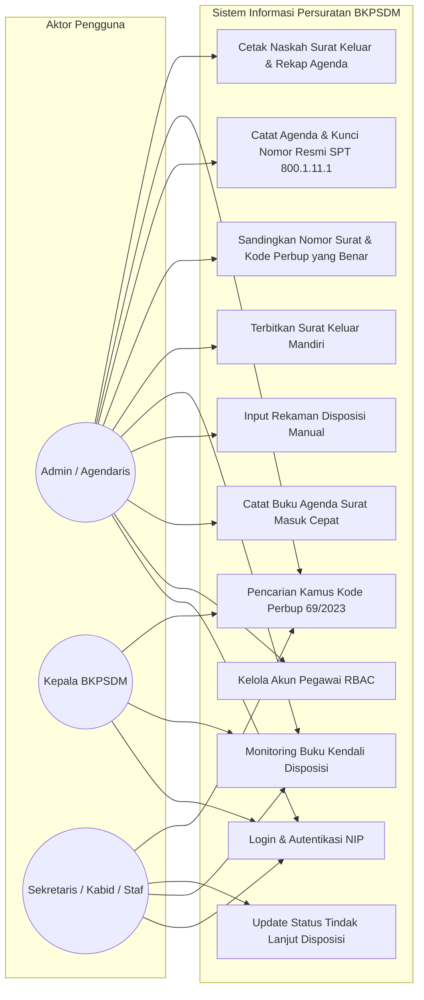
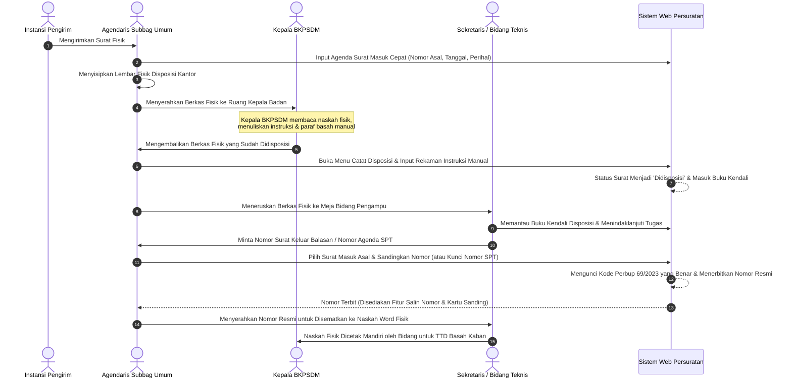

# BAB IV
# HASIL DAN PEMBAHASAN

## 4.1 Hasil Penelitian

Penelitian ini menghasilkan sebuah perangkat lunak sistem tata kelola persuratan kedinasan bernama **Sistem Informasi Persuratan Berbasis Web pada Badan Kepegawaian dan Pengembangan Sumber Daya Manusia (BKPSDM) Kabupaten Luwu Timur**. Pengembangan sistem ini dilaksanakan secara disiplin dan bertahap memedomani metode *Software Development Life Cycle* (SDLC) model **Waterfall** yang meliputi tahap analisis kebutuhan, perancangan sistem (*design*), implementasi (*coding*), pengujian (*testing*), serta penyebaran dan pemeliharaan (*maintenance*).

Pembangunan sistem ini merujuk secara ketat pada regulasi resmi kearsipan daerah, yaitu **Peraturan Bupati Luwu Timur Nomor 69 Tahun 2023 tentang Kode Klasifikasi Arsip di Lingkungan Pemerintah Daerah** (turunan dari Permendagri Nomor 83 Tahun 2022), dengan penekanan utama pada klaster **800 (Kepegawaian)** yang menjadi tugas pokok dan fungsi (tupoksi) utama BKPSDM Kabupaten Luwu Timur.

---

### 4.1.1 Analisis Sistem yang Sedang Berjalan (Existing System)

Berdasarkan hasil observasi dan wawancara mendalam yang dilakukan di Subbagian Umum dan Kepegawaian BKPSDM Kabupaten Luwu Timur, alur pengelolaan naskah dinas yang berjalan sebelum adanya sistem informasi adalah sebagai berikut:

#### Deskripsi Prosedur Manual:
1. **Penerimaan Surat Masuk:** Surat dinas fisik dari instansi luar (Organisasi Perangkat Daerah/OPD lain, instansi vertikal, maupun instansi swasta) diterima oleh staf Subbagian Umum/Agendaris.
2. **Pencatatan Agenda Fisik:** Agendaris menuliskan identitas surat (nomor surat pengirim, asal instansi, tanggal surat, dan perihal) ke dalam buku agenda besar berbentuk buku tulis fisik bergaris.
3. **Penyertaan Lembar Disposisi Fisik Kantor:** Kantor BKPSDM telah memiliki stok cetakan resmi lembar disposisi kertas kosong. Agendaris menjepitkan lembar kertas tersebut pada map surat dinas, lalu membawa map fisik tersebut ke ruangan Kepala BKPSDM (*PARHA ARIEF, S.AP*).
4. **Disposisi Manual oleh Pimpinan:** Kepala BKPSDM membaca isi surat, memilih kotak instruksi menggunakan pulpen (misalnya: *Tindak lanjuti, Hadiri, Pelajari/Telaah, Koordinasikan*), menuliskan catatan khusus arahan pimpinan, dan membubuhkan paraf atau tanda tangan basah langsung pada lembar kertas tersebut.
5. **Distribusi Fisik Naskah:** Lembar disposisi yang telah diparaf basah kemudian dibawa kembali ke Subbag Umum untuk difotokopi atau langsung diserahkan secara fisik ke meja pejabat struktural penerima disposisi (Sekretaris Badan atau Kepala Bidang terkait).
6. **Pembuatan Naskah Balasan / Surat Keluar:** Pejabat struktural atau staf analis kepegawaian menyusun konsep naskah surat dinas balasan menggunakan aplikasi pengolah kata (*Microsoft Word*).
7. **Penomoran Surat Keluar:** Staf membawa draf surat keluar ke agendaris untuk meminta nomor surat resmi. Agendaris melihat buku register surat keluar fisik untuk mencatat nomor urut berikutnya.

---

### 4.1.2 Identifikasi Permasalahan Sistem yang Berjalan

Berdasarkan analisis alur kerja sistem manual di atas, diidentifikasi beberapa permasalahan mendasar yang menjawab **Rumusan Masalah 1 dan 2** pada Bab I penelitian ini:

1. **Ketiadaan Buku Kendali Monitoring Disposisi:**
   Setelah berkas surat fisik dibawa ke ruangan pejabat struktural, agendaris maupun pimpinan kehilangan jejak (*losing track*) mengenai posisi berkas naskah dan sejauh mana tindak lanjut arahan telah dilaksanakan.
2. **Kerapuhan dan Risiko Kerusakan Buku Agenda Fisik:**
   Pencatatan yang bertumpu pada lembaran kertas buku agenda berisiko robek, terkena tumpahan air, aus akibat frekuensi buka-tutup halaman, serta sangat sulit ditelusuri kembali (*information retrieval*) ketika pimpinan membutuhkan riwayat surat masuk beberapa bulan yang lalu.
3. **Ketidaksesuaian Kodifikasi Surat Keluar (Human Error):**
   Pada sistem manual, agendaris kerap kali mengalami keraguan dalam menentukan kode klasifikasi arsip yang tepat di antara ribuan kode klasifikasi yang ada. Seringkali agendaris hanya menyalin mentah-mentah kode klasifikasi yang tercantum pada surat pengirim. Padahal instansi luar pengirim surat sering kali menggunakan kode klasifikasi yang keliru atau tidak sesuai dengan tata naskah kepegawaian BKPSDM berdasarkan Perbup Luwu Timur No. 69 Tahun 2023.
4. **Ketiadaan Mekanisme Penyandingan (*Pairing*) Nomor Surat Balasan:**
   Tidak tersedianya kartu kendali yang menghubungkan secara eksplisit antara **Nomor Surat Asal dari Pengirim** dengan **Nomor Surat Keluar Resmi BKPSDM** yang menjawab surat tersebut, sehingga arsip balasan terpisah dari surat masuk asalnya.

---

### 4.1.3 Analisis Kebutuhan Sistem Baru

Guna mengatasi kelemahan sistem berjalan tanpa mengubah kultur kedinasan yang telah baku, sistem baru dirancang memenuhi spesifikasi kebutuhan fungsional dan non-fungsional sebagai berikut:

#### A. Kebutuhan Fungsional (*Functional Requirements*):
1. **Pengelolaan Akun & Hak Akses Berjenjang (RBAC):** Sistem harus mengamankan otentikasi pengguna menggunakan NIP resmi 18 digit dan membagi hak akses ke dalam 5 peran kedinasan: Administrator/Agendaris, Kepala BKPSDM, Sekretaris Badan, Kepala Bidang, dan Staf Pelaksana.
2. **Pencatatan Buku Agenda Surat Masuk Digital (Pencatatan Cepat):** Sistem harus mampu mencatat nomor registrasi agenda otomatis, nomor surat asal pengirim, instansi pengirim, perihal ringkas, tanggal diterima, sifat naskah, dan penetapan kode klasifikasi kearsipan internal BKPSDM secara cepat dan efisien tanpa membebani agendaris dengan pemindaian lampiran berkas fisik yang diedarkan manual bersama lembar disposisi.
3. **Buku Kendali Disposisi Manual (Perekaman Arahan Pimpinan):** Sesuai kondisi riil di mana lembar fisik disposisi telah dicetak resmi oleh dinas dan disposisi dilakukan manual oleh Kepala BKPSDM dengan tulisan tangan dan paraf basah, maka sistem **tidak perlu mencetak blanko kosong**. Sistem berfungsi merekam (*logging*) hasil instruksi manual, catatan khusus, pejabat tujuan, dan batas waktu penyelesaian ke dalam **Buku Kendali Digital** agar status penyelesaian dapat dipantau bersama secara *real-time*.
4. **Penyandingan Nomor Surat Keluar & Validasi Kode Perbup yang Benar:** Sistem harus menyediakan fitur relasional untuk mengaitkan surat keluar balasan dengan surat masuk asalnya. Sistem harus secara tegas menyandingkan nomor pengirim asal dengan nomor keluar resmi BKPSDM, sekaligus memvalidasi bahwa kode klasifikasi yang dipakai adalah **kode klasifikasi yang benar** memedomani Perbup Luwu Timur No. 69 Tahun 2023.
5. **Mesin Rekomendasi Pintar (*Smart Auto-Suggest Engine*):** Saat pengguna mengetikkan perihal surat (misalnya: *"usulan kenaikan pangkat"*), sistem secara otomatis mencocokkan kata kunci ke dalam kamus 2.961 kode klasifikasi arsip daerah dan menyajikan rekomendasi kode tercepat dalam waktu < 15 milidetik.
6. **Buku Agenda & Penomoran Resmi Surat Perintah Tugas (SPT) Terpusat:** Sistem harus menyediakan modul buku agenda khusus untuk mencatat dan mengunci penomoran resmi digital terpusat (*centralized digital numbering*) bagi SPT kedinasan (kode `800.1.11.1`) guna mencegah penomoran ganda atau loncat antar-bidang. Sistem mencatat bidang pengusul penugasan, personil aparatur yang ditugaskan, maksud perjalanan dinas, lokasi, tanggal tugas, serta fitur salin nomor cepat (*copy-to-clipboard*). Naskah fisik SPT disusun dan dicetak secara mandiri oleh bidang teknis pembuat untuk ditandatangani basah oleh Kepala BKPSDM.
7. **Pencarian Cepat Kamus Perbup 69/2023:** Sistem menyediakan antarmuka pencarian cepat seluruh regulasi kode klasifikasi kearsipan daerah Kabupaten Luwu Timur yang terbagi ke dalam tab kategori (Kepegawaian 800, Umum 000, Pemerintahan 100, Keuangan 900, dll).

#### B. Kebutuhan Non-Fungsional (*Non-Functional Requirements*):
1. **Kinerja & Kecepatan (*Performance*):** Waktu pencarian dan pemfilteran 2.961 entri klasifikasi arsip harus berlangsung instan (*real-time in-memory filtering*) tanpa menyebabkan kelambatan (*lag*) pada peramban web (*browser*).
2. **Portabilitas Penuh (*Portability & Zero-Dependency*):** Aplikasi dapat dijalankan secara instan pada lingkungan pengujian/sidang skripsi tanpa memerlukan instalasi perangkat lunak server web pihak ketiga yang rumit.
3. **Keandalan & Integritas Data (*Reliability & Backup*):** Seluruh data persuratan dan relasi antar-tabel harus tersinkronisasi secara otomatis ke dalam skrip cadangan basis data SQL standar ANSI/MySQL (`database_persuratan.sql`).

---

### 4.1.4 Perancangan Sistem Baru

#### A. Pemodelan Use Case Diagram
Arsitektur fungsional sistem informasi persuratan dimodelkan menggunakan *Unified Modeling Language* (UML) Use Case Diagram dengan 3 kelompok aktor utama: **Admin / Agendaris Subbag Umum**, **Pimpinan (Kepala BKPSDM)**, dan **Pejabat Struktural / Staf Pelaksana**:

#### B. Skenario Alur Kerja (Activity Diagram)
Berikut adalah alur terintegrasi antara proses administrasi fisik kantor dengan sistem informasi persuratan:

#### C. Perancangan Basis Data Relasional (Entity Relationship)
Arsitektur basis data sistem dirancang memedomani prinsip relasional MySQL dengan 7 tabel utama:

1. **`pegawai`**: Menyimpan identitas aparatur, NIP, nama lengkap, pangkat/golongan, jabatan kedinasan, unit kerja, kata sandi, dan peran hak akses (*Role-Based Access Control*).
2. **`klasifikasi_arsip`**: Memuat 2.961 entri hierarki kode klasifikasi arsip berdasarkan Peraturan Bupati Luwu Timur Nomor 69 Tahun 2023 lengkap dengan kategori dan kata kunci pencarian.
3. **`surat_masuk`**: Menyimpan nomor agenda urut internal, nomor surat asli pengirim, nama instansi pengirim, perihal surat, tanggal surat, tanggal diterima, sifat naskah, kode kearsipan usulan, dan status disposisi.
4. **`disposisi`**: Menyimpan data rekaman instruksi manual Kepala BKPSDM, pejabat struktural tujuan, sifat arahan, rincian instruksi tulisan tangan, catatan khusus, batas waktu penyelesaian, dan status tindak lanjut penanganan. Memiliki *foreign key* berelasi ke tabel `surat_masuk` dan `pegawai`.
5. **`surat_keluar`**: Menyimpan nomor agenda surat keluar, nomor surat resmi BKPSDM format `[KODE]/[URUT]/BKPSDM/[ROMAWI]/[TAHUN]`, identitas bidang/unit kerja pembuat naskah (`bidang_pembuat`), tujuan surat, perihal, penandatangan, metode fisik dokumen, bendera surat balasan (`is_surat_balasan`), tautan relasi ke `id_surat_masuk_asal`, serta `no_surat_pengirim_asal`.
6. **`surat_tugas`**: Menyimpan buku agenda Surat Perintah Tugas (SPT) khusus kode `800.1.11.1`, nomor urut resmi digital terpusat, identitas bidang/unit kerja pengusul penugasan (`bidang_pengusul`), dasar hukum penugasan, maksud kedinasan, lokasi tujuan, rentang tanggal penugasan, lama hari kerja, dan pembebanan anggaran.
7. **`surat_tugas_personil`**: Tabel relasi *many-to-many* antara satu naskah `surat_tugas` dengan banyak personil `pegawai` yang ditugaskan dalam surat perintah tersebut.

---

### 4.1.5 Implementasi Antarmuka Sistem

Implementasi antarmuka (*user interface*) dibangun menggunakan pendekatan *Modern Clean Office Design* dengan palet warna biru kedinasan (*deep navy*), tipografi standar modern, serta penataan tata letak (*layout*) yang ergonomis.

#### 1. Halaman Autentikasi Pengguna & Panel Akses Cepat Simulasi Sidang
Halaman login dirancang sebagai gerbang masuk resmi aparatur BKPSDM. Dilengkapi panel *Simulasi Akses Cepat (1-Click Login)* yang mempermudah penguji atau mahasiswa mendemonstrasikan perpindahan peran (Admin, Kepala BKPSDM, Sekretaris, Kabid, Staf Pelaksana) secara instan saat sidang skripsi berlangsung:

#### 2. Halaman Dashboard & Monitoring Persuratan Real-time
Menampilkan ringkasan statistik persuratan secara komprehensif, mencakup jumlah surat masuk bulan berjalan, volume surat keluar, status antrean disposisi manual, serta pintasan cepat menuju modul operasional:

#### 3. Modul Kelola Pegawai & Hak Akses Pengguna (RBAC)
Menyajikan daftar aparatur di lingkungan BKPSDM Kabupaten Luwu Timur lengkap dengan NIP, pangkat, jabatan, dan wewenang sistem. Administrator dapat menambah aparatur baru dengan validasi format NIP 18 digit:

#### 4. Pratinjau Berkas Digital Surat Masuk (Format Naskah A4)
Menampilkan naskah dinas surat masuk dalam format lembar kerja A4 resmi, lengkap dengan nomor surat pengirim, stempel registrasi agenda masuk, dan kode klasifikasi kearsipan internal BKPSDM:

#### 5. Modul Buku Kendali Disposisi Manual Kepala BKPSDM
Sesuai kebutuhan lapangan di mana lembar fisik disposisi telah dicetak resmi di kantor dan instruksi ditulis tangan oleh Kepala BKPSDM (*PARHA ARIEF, S.AP*), modul ini berfungsi sebagai **Buku Kendali Digital**. Staf agendaris merekam ringkasan centangan instruksi dan catatan pimpinan dari lembar kertas fisik ke dalam sistem. Di sini tidak ada fitur cetak blanko kosong, melainkan tombol untuk **Merekam Hasil Disposisi Manual** dan **Melihat Rekaman Disposisi**:

#### 6. Lembar Kartu Kendali Penyandingan Nomor Surat Keluar & Kode Klasifikasi yang Benar
Fitur unggulan kearsipan yang menyandingkan secara berdampingan antara **Nomor Surat Asal dari Instansi Pengirim** dengan **Nomor Surat Keluar Resmi BKPSDM**. Sistem secara cerdas mengunci dan mengadopsi **Kode Klasifikasi Arsip yang Benar** sesuai Perbup Luwu Timur Nomor 69 Tahun 2023:

#### 7. Naskah Dinas Resmi Surat Keluar A4 dengan Box Rujukan Penyandingan
Format cetak naskah surat dinas keluar ukuran A4 yang memuat kop surat resmi lambang Pemerintah Kabupaten Luwu Timur, nomor surat terformat otomatis, box rujukan penyandingan nomor surat masuk asal, serta stempel dinas dan tanda tangan basah pimpinan:

#### 8. Modul Buku Agenda & Kartu Kendali Penomoran SPT Terpusat
Menyajikan antarmuka buku agenda Surat Perintah Tugas (SPT) kedinasan (kode `800.1.11.1`) yang dikelola oleh Subbagian Umum. Menampilkan nomor registrasi resmi terpusat, identitas bidang pengusul penugasan, rincian personil aparatur yang ditugaskan, maksud perjalanan dinas, lokasi, tanggal penugasan, serta tombol pintas **"Salin No"** (*clipboard*) dan **"Detail Agenda"**. Hal ini sejalan dengan pembagian wewenang kedinasan di mana naskah fisik SPT disusun dan dicetak mandiri oleh bidang teknis pengusul, sedangkan sistem web berfungsi sebagai pengunci nomor resmi agar tidak terjadi nomor ganda antar-bidang:

#### 9. Formulir Pencatatan Cepat Surat Masuk (Tanpa Beban Lampiran Fisik)
Formulir input surat masuk yang dioptimalkan untuk pencatatan cepat data naskah dinas dari instansi luar (nomor surat pengirim, instansi pengirim, perihal, dan tanggal diterima) yang langsung disandingkan dengan rekomendasi pintar (*smart auto-suggest*) kode klasifikasi kearsipan internal BKPSDM memedomani Perbup 69/2023, tanpa memperlambat alur kerja registrasi dengan pemindaian lampiran berkas fisik yang telah diedarkan manual bersama lembar disposisi pimpinan:

#### 10. Profil Pengguna & Keamanan Akun (Fitur Ubah Kata Sandi)
Modal profil aparatur yang dapat diakses dengan mengklik avatar pengguna di bilah navigasi atas. Menyajikan NIP resmi, pangkat/golongan, jabatan, hak akses (RBAC), serta formulir pengubahan kata sandi (*password*) akun aparatur secara mandiri:

---

## 4.2 Pengujian Sistem (Testing)

Pengujian perangkat lunak dilakukan menggunakan metode **Black Box Testing** (pengujian kotak hitam) untuk memverifikasi fungsionalitas sistem informasi dari perspektif pengguna tanpa harus memeriksa struktur internal kode program. Pengujian difokuskan pada validitas masukan (*input*), ketepatan proses bisnis (*processing*), dan kesesuaian keluaran (*output*) terhadap kebutuhan pengguna.

### 4.2.1 Tabel Hasil Pengujian Black Box Testing

Berikut adalah rekapitulasi hasil pengujian fungsionalitas sistem yang mencakup 22 kasus uji komprehensif:

| No | Kasus Uji | Skenario Pengujian | Hasil yang Diharapkan | Hasil Pengujian | Kesimpulan |
| :---: | :--- | :--- | :--- | :--- | :---: |
| **1** | Autentikasi Pengguna (Login) | Memasukkan NIP dan kata sandi yang terdaftar pada sistem, lalu menekan tombol "Masuk ke Sistem Persuratan". | Sistem memvalidasi kredensial, menyimpan status sesi pengguna, dan menampilkan halaman Dashboard sesuai peran aparatur. | Sistem berhasil masuk ke Dashboard dan menampilkan nama serta jabatan pengguna pada header. | **VALID** |
| **2** | Akses Cepat Simulasi Sidang | Menekan salah satu tombol akun aparatur pada panel "Simulasi Akses Cepat (Sidang Skripsi)". | Sistem secara instan mengautentikasi pengguna terpilih tanpa perlu memasukkan NIP secara manual. | Sistem langsung login sebagai pejabat/staf terpilih dan memperbarui hak akses menu. | **VALID** |
| **3** | Keluar Sistem (Logout) | Menekan tombol "Keluar" pada pojok kanan atas bilah navigasi header dan mengonfirmasi dialog. | Sistem mengakhiri sesi aktif pengguna dan mengarahkan kembali ke halaman login resmi. | Pengguna berhasil keluar dari sesi dan halaman login resmi ditampilkan kembali. | **VALID** |
| **4** | Pencatatan Surat Masuk Baru | Mengisi data instansi pengirim, nomor surat asal, mengetik perihal surat di buku agenda, dan memilih kode klasifikasi usulan. | Sistem mencatat surat masuk, memberikan nomor agenda urut otomatis, dan menyandingkan kode kearsipan. | Data surat masuk tersimpan dan muncul pada tabel dengan status "Menunggu Disposisi". | **VALID** |
| **5** | Fitur Auto-suggest Kode Perbup | Mengetik kata kunci perihal (contoh: "Cuti", "Pangkat", "Disiplin") pada formulir surat masuk/keluar. | Algoritma *smart auto-suggest* mencocokkan kata kunci ke kamus 2.961 kode Perbup 69/2023 secara *real-time*. | Rekomendasi kode klasifikasi dan deskripsinya muncul seketika di bawah kolom isian. | **VALID** |
| **6** | Pratinjau Berkas Digital A4 | Menekan tombol "Berkas" pada baris data surat masuk. | Sistem menampilkan modal pratinjau lembar naskah dinas digital format A4 lengkap dengan kop, isi, dan tanda registrasi arsip. | Modal pratinjau lembar naskah dinas A4 muncul secara rapi dan tombol cetak berfungsi normal. | **VALID** |
| **7** | Perekaman Disposisi Manual ke Sistem | Menekan tombol "✍️ Catat Disposisi" pada baris surat masuk, menyalin instruksi centangan dan catatan tulisan tangan pimpinan dari lembar fisik kantor. | Sistem menyimpan ringkasan instruksi tulisan tangan ke dalam buku kendali digital dan memperbarui status surat menjadi "Didisposisi". | Hasil disposisi manual tersimpan rapi di buku kendali digital dan status surat terbarui. | **VALID** |
| **8** | Monitoring Buku Kendali Disposisi | Membuka menu Buku Kendali Disposisi untuk memantau surat yang telah didisposisi manual dan status tindak lanjut oleh pejabat terkait. | Sistem menyajikan rekapitulasi pejabat tujuan, instruksi pimpinan, batas waktu, dan status tindak lanjut surat. | Daftar disposisi manual pimpinan tersaji terstruktur dan status tindak lanjut dapat diperbarui. | **VALID** |
| **9** | Pembuatan Surat Keluar Mandiri | Mengisi perihal surat keluar baru, memilih kode klasifikasi arsip, dan menetapkan tujuan surat. | Sistem mengunci nomor urut surat resmi dengan format `[KODE]/[URUT]/BKPSDM/[ROMAWI]/[TAHUN]`. | Nomor surat keluar resmi diterbitkan dan dicatat ke dalam buku kendali surat keluar. | **VALID** |
| **10** | Penyandingan Nomor Surat & Kode Perbup yang Benar | Memilih opsi "Ya, Balasan atas Surat Masuk", memilih surat masuk asal dari pengirim, dan memverifikasi kode Perbup yang benar. | Sistem menyandingkan nomor surat asal pengirim dengan nomor surat keluar resmi BKPSDM serta mengadopsi kode klasifikasi kearsipan yang benar sesuai Perbup 69/2023. | Nomor pengirim asal dan nomor BKPSDM tersandingkan secara logis berdampingan pada kartu kendali dan naskah dinas resmi. | **VALID** |
| **11** | Deteksi Berkas Rahasia (Disiplin/Cerai) | Memilih kode klasifikasi rahasia (contoh: `800.1.6.2` Hukuman Disiplin atau `800.1.8.1` Izin Perceraian). | Sistem otomatis mengunci sifat surat menjadi "Rahasia" dan menetapkan tata cara fisik naskah bersampul segel tertutup. | Peringatan naskah beramplop segel muncul dan metode dokumen otomatis diset fisik beramplop. | **VALID** |
| **12** | Pratinjau Naskah Dinas Resmi A4 | Menekan tombol "Naskah" pada baris data surat keluar. | Sistem menampilkan modal naskah dinas resmi BKPSDM Luwu Timur lengkap dengan kop lambang daerah, stempel dinas, dan box rujukan penyandingan nomor. | Naskah dinas resmi tampil sempurna dalam format lembar surat A4 dengan stempel dinas ganda. | **VALID** |
| **13** | Pencatatan Agenda & Penomoran Resmi SPT Multi-Pegawai | Memilih bidang pengusul penugasan, mengisi maksud kedinasan, memilih beberapa personil aparatur pelaksana, lokasi tujuan, dan tanggal penugasan. | Sistem mengunci nomor urut resmi SPT secara terpusat format `800.1.11.1/[URUT]/BKPSDM/[ROMAWI]/[TAHUN]`, mencatat ke buku agenda, dan mengaitkan personil secara relasional. | Nomor resmi SPT berhasil diterbitkan, data agenda tersimpan, dan kartu kendali penugasan muncul pada tabel. | **VALID** |
| **14** | Penelusuran Kamus Perbup 69/2023 | Membuka menu Kamus Perbup 69/2023, memilih tab filter (Kepegawaian 800, Umum 000, dll) atau mengetik pencarian. | Sistem memfilter 2.961 entri kode arsip resmi daerah Kabupaten Luwu Timur secara instan. | Data hierarki kode arsip ditampilkan lengkap beserta penanda status aktif dan retensi arsip. | **VALID** |
| **15** | Rekapitulasi Buku Agenda & Laporan | Membuka menu Buku Agenda & Rekap, memfilter berdasarkan rentang tanggal dan jenis naskah persuratan. | Sistem menyajikan rekapitulasi agenda dinas dan menyediakan tombol cetak laporan bulanan/tahunan. | Rekapitulasi agenda persuratan tampil presisi dan siap dicetak untuk pelaporan ke pimpinan. | **VALID** |
| **16** | Manajemen Pengguna (Tambah Pegawai) | Mengisi formulir pendaftaran aparatur (NIP, nama, pangkat, jabatan, hak akses) dan menekan "Daftarkan Pegawai". | Sistem memvalidasi keunikan NIP dan menyimpan data akun aparatur baru ke dalam tabel pegawai. | Akun aparatur baru berhasil ditambahkan dan langsung muncul pada tabel daftar aparatur. | **VALID** |
| **17** | Manajemen Pengguna (Ubah & Hapus) | Mengubah data jabatan/peran pegawai atau menghapus akun simulasi yang tidak aktif. | Sistem memperbarui data pegawai atau menghapus akun setelah konfirmasi persetujuan dari administrator. | Data akun berhasil diperbarui atau dihapus secara aman dari sistem. | **VALID** |
| **18** | Sinkronisasi Basis Data MySQL | Menjalankan mutasi data persuratan (tambah surat masuk, surat keluar, disposisi, pegawai). | Server secara otomatis menyinkronkan seluruh perubahan ke file `database_persuratan.sql` standar MySQL. | File SQL terbarui secara konsisten dengan struktur `CREATE TABLE` dan data `INSERT INTO` yang valid. | **VALID** |
| **19** | Fitur Ubah dan Hapus Persuratan (Full CRUD) | Menekan tombol "Ubah" atau "Hapus" pada baris Surat Masuk, Surat Keluar, Disposisi, atau SPT. | Sistem menampilkan form edit terisi lengkap atau meminta konfirmasi penghapusan aman. | Data berhasil diperbarui atau dihapus secara konsisten dari memori dan basis data. | **VALID** |
| **20** | Pencatatan Cepat Surat Masuk (Tanpa Beban Lampiran) | Mengisi data identitas surat masuk (nomor asal pengirim, instansi, tanggal, dan perihal) pada form tambah surat masuk tanpa lampiran berkas. | Sistem mencatat agenda surat masuk secara instan dan efisien tanpa hambatan pemrosesan unggah berkas fisik tebal. | Data surat masuk berhasil tersimpan seketika di buku agenda dan siap untuk direkam disposisinya. | **VALID** |
| **21** | Fitur Salin Nomor Resmi SPT ke Clipboard | Menekan tombol "Salin No" pada baris data agenda Surat Perintah Tugas. | Sistem menyalin nomor surat resmi SPT secara instan ke papan klip (*clipboard*) sistem operasi untuk ditempelkan pada naskah Word bidang pembuat. | Nomor resmi SPT berhasil disalin ke clipboard dan notifikasi sukses penyalinan ditampilkan. | **VALID** |
| **22** | Pengubahan Kata Sandi Akun Mandiri | Membuka modal profil pengguna dari bilah header, mengisi kata sandi lama, kata sandi baru, dan konfirmasi. | Sistem memvalidasi kata sandi lama dan memperbarui kata sandi baru pada basis data akun. | Kata sandi berhasil diperbarui dan notifikasi sukses ditampilkan. | **VALID** |

### 4.2.2 Rekapitulasi dan Analisis Hasil Pengujian Black Box
Berdasarkan seluruh hasil pengujian *Black Box Testing* pada Tabel 4.1 di atas, 22 dari 22 kasus uji (100%) menunjukkan hasil yang **VALID**. Fungsionalitas sistem telah berjalan sesuai dengan spesifikasi kebutuhan yang dirumuskan, tidak ditemukan galat (*error*) kritis, dan seluruh komponen sistem mampu berinteraksi secara harmonis sesuai aturan tata persuratan kedinasan.

---

### 4.2.3 Hasil Pengujian Usability (System Usability Scale / SUS)

Pengujian usability dilakukan untuk mengukur tingkat kepuasan, kemudahan navigasi, efisiensi alur kerja, dan penerimaan pengguna akhir (*end-user acceptance*) terhadap Sistem Informasi Persuratan Berbasis Web pada BKPSDM Kabupaten Luwu Timur. Mengikuti pedoman penulisan skripsi Fakultas Ilmu Komputer Universitas Mega Buana Palopo serta rujukan penelitian sejenis terdahulu yang telah disetujui dewan penguji (Taufiq, 2024), pengujian usability ini memedomani instrumen baku internasional **System Usability Scale (SUS)** (Brooke, 1996; Lewis, 2018), yang telah diadaptasi ke dalam Bahasa Indonesia dengan tingkat reliabilitas tinggi (*Cronbach's Alpha* 0,841) oleh Sharfina & Santoso (2016).

#### A. Karakteristik Instrumen dan Formula Perhitungan SUS
Metode SUS terdiri atas 10 butir instrumen pernyataan baku dengan 5 pilihan Skala Likert:
1. Skor 1 = Sangat Tidak Setuju (STS)
2. Skor 2 = Tidak Setuju (TS)
3. Skor 3 = Netral / Ragu-ragu (N)
4. Skor 4 = Setuju (S)
5. Skor 5 = Sangat Setuju (SS)

Rincian kesepuluh butir pernyataan kuesioner baku SUS meliputi:
1. **Butir Q1 (Positif):** Saya berpikir akan sering menggunakan sistem informasi persuratan ini dalam pekerjaan sehari-hari.
2. **Butir Q2 (Negatif):** Saya merasa sistem informasi persuratan ini terlalu rumit untuk digunakan.
3. **Butir Q3 (Positif):** Saya merasa sistem informasi persuratan ini mudah untuk digunakan.
4. **Butir Q4 (Negatif):** Saya rasa saya memerlukan bantuan tenaga ahli teknis untuk dapat mengoperasikan sistem ini.
5. **Butir Q5 (Positif):** Saya menemukan bahwa berbagai fungsi dan fitur dalam sistem ini telah terintegrasi dengan sangat baik.
6. **Butir Q6 (Negatif):** Saya merasa sistem persuratan ini memiliki terlalu banyak hal yang tidak konsisten.
7. **Butir Q7 (Positif):** Saya merasa kebanyakan rekan pegawai akan memahami cara menggunakan sistem ini dengan sangat cepat.
8. **Butir Q8 (Negatif):** Saya merasa sistem informasi persuratan ini membingungkan atau kaku saat digunakan.
9. **Butir Q9 (Positif):** Saya merasa percaya diri saat mengoperasikan sistem informasi persuratan ini.
10. **Butir Q10 (Negatif):** Saya perlu belajar banyak hal terlebih dahulu sebelum saya dapat mengoperasikan sistem ini dengan lancar.

Aturan konversi matematis baku SUS memedomani formula Brooke (1996) sebagai berikut:
1. Untuk butir bernomor ganjil (pernyataan bersentimen positif: Q1, Q3, Q5, Q7, Q9), formula konversi skor adalah nilai pilihan responden dikurangi 1:
   $$\text{Skor Item Ganjil} = X_i - 1$$
2. Untuk butir bernomor genap (pernyataan bersentimen negatif: Q2, Q4, Q6, Q8, Q10), formula konversi skor adalah 5 dikurangi nilai pilihan responden:
   $$\text{Skor Item Genap} = 5 - X_i$$
3. Skor akhir SUS untuk tiap responden diperoleh dengan menjumlahkan seluruh skor terkonversi dari kesepuluh butir pertanyaan, lalu dikalikan dengan faktor pengali 2,5 sehingga diperoleh rentang skor standar antara 0 hingga 100:
   $$\text{Skor Akhir SUS} = \left( \sum_{i=1}^{10} \text{Skor Item Terkonversi}_i \right) \times 2,5$$

Tingkat kelayakan dan keberterimaan sistem diklasifikasikan memedomani standar interpretasi *Adjective Rating* dan *Acceptability Ranges* (Bangor, Kortum, & Miller, 2008):
1. Skor $\ge 80,3$ : Kategori *Excellent / Grade A* (Tingkat Penerimaan: *Acceptable* / Sangat Layak dan Diterima).
2. Skor $68,0 - 80,2$ : Kategori *Good / Grade B* (Tingkat Penerimaan: *Acceptable* / Diterima).
3. Skor $51,0 - 67,9$ : Kategori *OK / Marginal* (Tingkat Penerimaan: *Marginal* / Cukup Diterima).
4. Skor $< 51,0$ : Kategori *Poor / Not Acceptable* (Tingkat Penerimaan: *Not Acceptable* / Tidak Diterima).

#### B. Distribusi Responden Pegawai BKPSDM Kabupaten Luwu Timur (Total Sampling / Sensus)
Pengujian usability ini menerapkan teknik **Sampling Jenuh (Total Sampling / Sensus)** memedomani Sugiyono (2019), di mana seluruh anggota populasi aparatur pegawai di lingkungan kantor BKPSDM Kabupaten Luwu Timur yang berjumlah **44 orang pegawai** dilibatkan secara penuh sebagai responden pengujian. Penentuan seluruh populasi ini menjamin bahwa setiap tingkatan peran kedinasan (*Role-Based Access Control*)—mulai dari pimpinan, pejabat struktural, pejabat pengawas, agendaris pengelola buku agenda pusat, hingga staf analis dan pelaksana teknis—memberikan evaluasi empiris terhadap sistem yang dibangun.

Tabel 4.2 Distribusi responden SUS berdasarkan peran kedinasan (Populasi 44 Pegawai)
| No | Kategori Peran Kedinasan | Target Sampel | Jumlah Responden Terisi | Persentase (%) |
| :---: | :--- | :---: | :---: | :---: |
| 1 | Pimpinan (Kepala BKPSDM & Sekretaris Badan) | 2 Orang | 2 Orang | 4,55% |
| 2 | Pejabat Struktural (Kepala Bidang Teknis) | 3 Orang | 3 Orang | 6,82% |
| 3 | Pejabat Pengawas (Kepala Subbagian) | 2 Orang | 2 Orang | 4,55% |
| 4 | Staf Agendaris / Operator Persuratan Subbag Umum | 3 Orang | 3 Orang | 6,82% |
| 5 | Staf Analis SDM Aparatur & Pelaksana Teknis Bidang | 34 Orang | 34 Orang | 77,27% |
| **Total** | **Seluruh Aparatur Pegawai BKPSDM Kabupaten Luwu Timur** | **44 Orang** | **44 Orang** | **100,00%** |

Berdasarkan Tabel 4.2 di atas, seluruh kuesioner yang diserahkan kepada 44 aparatur pegawai BKPSDM Kabupaten Luwu Timur telah kembali dan terisi lengkap 100% (*response rate* 100%). Komposisi ini mencakup 100% populasi aparatur di BKPSDM Kabupaten Luwu Timur, di mana porsi terbesar (77,27%) adalah staf analis kepegawaian, pranata komputer, arsiparis, dan pengadministrasi yang bertugas menyusun naskah dinas, didukung unsur pejabat struktural dan pengawas (18,19%) serta pimpinan tertinggi badan (4,55%).

#### C. Ringkasan Hasil Perhitungan Skor Usability (SUS)
Berdasarkan hasil pengolahan data kuesioner SUS dari seluruh 44 responden aparatur pegawai BKPSDM Kabupaten Luwu Timur, ringkasan capaian metrik usability sistem disajikan pada Tabel 4.3 berikut:

Tabel 4.3 Ringkasan hasil perhitungan skor usability SUS (44 Responden)
| Metrik Pengujian Usability | Nilai Capaian Metrik | Standar Acuan & Interpretasi Ilmiah |
| :--- | :---: | :--- |
| Jumlah Responden Penguji | **44 Orang Pegawai** | Sensus / Total Sampling seluruh aparatur BKPSDM |
| Total Skor Kumulatif SUS | **3.577,50** | Penjumlahan skor SUS dari 44 responden |
| Rata-rata Skor Akhir SUS | **81,31** | Jauh melampaui rata-rata standar global (68,00) |
| Grade Skala (*Letter Grade*) | **Grade A** | Standar Bangor et al. (Ambang Grade A $\ge 80,3$) |
| Predikat Kualitas (*Adjective Rating*) | **Excellent** | Kualitas antarmuka dan interaksi dinilai Sangat Baik |
| Tingkat Penerimaan (*Acceptability*) | **Acceptable** | Sistem Sangat Layak dan Diterima untuk Operasional |
| Skor Responden Tertinggi | **87,50** | Diperoleh Kasubag Umum dan Staf Agendaris Subbag Umum |
| Skor Responden Terendah | **72,50** | Tetap berada di atas ambang batas *Acceptable* (> 70) |
| Rentang Variasi Skor (*Score Range*) | **15,00** | Variasi jawaban rendah, persepsi pengguna homogen |

Berdasarkan Tabel 4.3 di atas, Sistem Informasi Persuratan Berbasis Web pada BKPSDM Kabupaten Luwu Timur memperoleh skor rata-rata SUS sebesar **81,31**. Mengacu pada klasifikasi standar baku Bangor, Kortum, & Miller (2008), skor 81,31 berada pada predikat **Grade A** dengan *Adjective Rating* **Excellent** (Sangat Baik) serta tingkat keberterimaan pengguna berada pada status **Acceptable** (Sangat Layak Diterima). Capaian 81,31 ini berada jauh di atas ambang batas rata-rata evaluasi sistem perangkat lunak secara internasional (*global baseline* SUS = 68,00), yang membuktikan secara empiris bahwa sistem memiliki kebergunaan tinggi, alur kerja efisien, dan diterima secara utuh oleh seluruh aparatur pengguna di lingkungan kantor BKPSDM Kabupaten Luwu Timur.

#### D. Matriks Rekapitulasi Data Responden dan Perhitungan Skor SUS (44 Pegawai)
Data mentah pilihan jawaban 44 responden aparatur pada butir pernyataan Q1 sampai Q10 beserta hasil perhitungan skor konversi Brooke (1996) disajikan secara rinci, transparan, dan dapat diverifikasi pada Tabel 4.4 berikut:

Tabel 4.4 Matriks rekapitulasi jawaban 44 responden dan perhitungan skor akhir SUS
| No | Kode | Inisial | Jabatan Kedinasan | Unit Kerja / Bidang | Q1 | Q2 | Q3 | Q4 | Q5 | Q6 | Q7 | Q8 | Q9 | Q10 | Total Konversi | Skor Akhir SUS |
| :---: | :---: | :---: | :--- | :--- | :---: | :---: | :---: | :---: | :---: | :---: | :---: | :---: | :---: | :---: | :---: | :---: |
| 1 | Resp-01 | PA | Kepala BKPSDM | Pimpinan | 4 | 2 | 4 | 1 | 5 | 2 | 4 | 2 | 4 | 2 | 32 | 80,00 |
| 2 | Resp-02 | AH | Sekretaris BKPSDM | Sekretariat | 4 | 1 | 4 | 2 | 4 | 1 | 4 | 2 | 4 | 1 | 33 | 82,50 |
| 3 | Resp-03 | SP | Kabid. Pengembangan Sumber Daya Aparatur | Bidang Pengembangan SDA | 5 | 1 | 4 | 2 | 4 | 2 | 4 | 2 | 4 | 2 | 32 | 80,00 |
| 4 | Resp-04 | BA | Kabid. Mutasi, Kepangkatan dan Pengembangan Karir | Bidang Mutasi & Karir | 4 | 2 | 5 | 2 | 4 | 2 | 4 | 1 | 4 | 2 | 32 | 80,00 |
| 5 | Resp-05 | AB | Kabid. Pengadaan, Pemberhentian, Kinerja dan Informasi Kepegawaian | Bidang Pengadaan, Pemberhentian & Info | 5 | 2 | 4 | 2 | 5 | 2 | 4 | 1 | 5 | 2 | 34 | 85,00 |
| 6 | Resp-06 | AS | Analis SDM Aparatur Ahli Muda | Bidang Pengembangan SDA | 4 | 2 | 4 | 2 | 4 | 1 | 4 | 1 | 4 | 2 | 32 | 80,00 |
| 7 | Resp-07 | AT | Analis SDM Aparatur Ahli Muda | Bidang Mutasi & Karir | 5 | 1 | 4 | 2 | 5 | 2 | 4 | 2 | 4 | 2 | 33 | 82,50 |
| 8 | Resp-08 | RA | Analis SDM Aparatur Ahli Muda (SP Towuti) | Sentra Pelayanan Towuti | 4 | 2 | 4 | 2 | 4 | 2 | 4 | 2 | 4 | 3 | 29 | 72,50 |
| 9 | Resp-09 | EL | Analis SDM Aparatur Ahli Muda | Bidang Pengadaan & Kinerja | 5 | 2 | 4 | 2 | 5 | 2 | 4 | 2 | 4 | 2 | 32 | 80,00 |
| 10 | Resp-10 | AG | Kasubag. Perencanaan dan Keuangan | Subbag Perencanaan & Keuangan | 4 | 2 | 4 | 2 | 4 | 2 | 4 | 2 | 4 | 2 | 30 | 75,00 |
| 11 | Resp-11 | NS | Kasubag. Umum dan Kepegawaian | Subbag Umum & Kepegawaian | 5 | 1 | 5 | 2 | 5 | 1 | 4 | 2 | 4 | 2 | 35 | 87,50 |
| 12 | Resp-12 | SN | Penelaah Teknis Kebijakan | Bidang Mutasi & Karir | 5 | 1 | 4 | 2 | 5 | 1 | 4 | 2 | 4 | 2 | 34 | 85,00 |
| 13 | Resp-13 | AT | Penelaah Teknis Kebijakan | Bidang Pengadaan & Kinerja | 5 | 2 | 4 | 1 | 5 | 2 | 4 | 2 | 4 | 2 | 33 | 82,50 |
| 14 | Resp-14 | HA | Analis SDM Aparatur Ahli Pertama | Bidang Pengembangan SDA | 4 | 2 | 5 | 2 | 4 | 2 | 4 | 1 | 4 | 2 | 32 | 80,00 |
| 15 | Resp-15 | SU | Pranata Komputer Ahli Pertama | Bidang Pengadaan, Kinerja & Info | 4 | 2 | 4 | 2 | 4 | 2 | 4 | 2 | 4 | 2 | 30 | 75,00 |
| 16 | Resp-16 | MS | Perencana Ahli Pertama / PPK | Subbag Perencanaan & Keuangan | 5 | 1 | 4 | 2 | 5 | 2 | 4 | 1 | 4 | 2 | 34 | 85,00 |
| 17 | Resp-17 | SU | Pengadministrasi Perkantoran | Subbag Umum & Kepegawaian | 5 | 1 | 5 | 2 | 5 | 1 | 4 | 2 | 4 | 2 | 35 | 87,50 |
| 18 | Resp-18 | RP | Penelaah Teknis Kebijakan | Bidang Mutasi & Karir | 5 | 1 | 4 | 2 | 5 | 2 | 4 | 2 | 4 | 2 | 33 | 82,50 |
| 19 | Resp-19 | MA | Pengadministrasi Perkantoran | Subbag Umum & Kepegawaian | 5 | 2 | 5 | 2 | 5 | 2 | 4 | 1 | 4 | 2 | 34 | 85,00 |
| 20 | Resp-20 | ER | Pengadministrasi Perkantoran | Bidang Pengadaan & Kinerja | 5 | 2 | 4 | 2 | 5 | 2 | 4 | 2 | 4 | 2 | 32 | 80,00 |
| 21 | Resp-21 | AF | Pengadministrasi Perkantoran | Subbag Umum & Kepegawaian | 4 | 2 | 5 | 1 | 4 | 2 | 4 | 2 | 4 | 2 | 32 | 80,00 |
| 22 | Resp-22 | AA | Arsiparis Ahli Pertama | Subbag Umum & Kepegawaian | 5 | 1 | 4 | 2 | 4 | 2 | 4 | 1 | 4 | 2 | 33 | 82,50 |
| 23 | Resp-23 | FL | Arsiparis Ahli Pertama | Subbag Umum & Kepegawaian | 5 | 1 | 4 | 2 | 5 | 1 | 4 | 2 | 4 | 2 | 34 | 85,00 |
| 24 | Resp-24 | NN | Teknisi Sarana dan Prasarana | Subbag Umum & Kepegawaian | 5 | 2 | 4 | 1 | 5 | 2 | 4 | 2 | 4 | 2 | 33 | 82,50 |
| 25 | Resp-25 | PN | Penata Kelola Sistem dan Teknologi Informasi | Bidang Pengadaan, Kinerja & Info | 4 | 2 | 5 | 2 | 4 | 2 | 4 | 1 | 4 | 2 | 32 | 80,00 |
| 26 | Resp-26 | NS | Analis Pengembangan Kompetensi | Bidang Pengembangan SDA | 5 | 1 | 4 | 2 | 5 | 2 | 4 | 1 | 4 | 2 | 34 | 85,00 |
| 27 | Resp-27 | HE | Analis Sumber Daya Manusia Aparatur | Bidang Mutasi & Karir | 5 | 2 | 4 | 2 | 4 | 2 | 4 | 1 | 4 | 2 | 32 | 80,00 |
| 28 | Resp-28 | ID | Analis Sumber Daya Manusia Aparatur | Bidang Pengadaan & Kinerja | 4 | 2 | 4 | 2 | 4 | 1 | 4 | 1 | 4 | 2 | 32 | 80,00 |
| 29 | Resp-29 | EJ | Analis Sumber Daya Manusia Aparatur | Bidang Pengembangan SDA | 5 | 1 | 4 | 2 | 5 | 2 | 4 | 2 | 4 | 2 | 33 | 82,50 |
| 30 | Resp-30 | NL | Pranata Sumber Daya Manusia Aparatur | Subbag Umum & Kepegawaian | 4 | 2 | 4 | 2 | 4 | 2 | 4 | 2 | 4 | 3 | 29 | 72,50 |
| 31 | Resp-31 | JU | Arsiparis Ahli Pertama (PPPK) | Subbag Umum & Kepegawaian | 5 | 2 | 4 | 2 | 5 | 2 | 4 | 2 | 4 | 2 | 32 | 80,00 |
| 32 | Resp-32 | ST | Perencana Ahli Pertama (PPPK) | Subbag Perencanaan & Keuangan | 4 | 2 | 5 | 1 | 4 | 2 | 4 | 2 | 4 | 2 | 32 | 80,00 |
| 33 | Resp-33 | SY | Analis SDM Aparatur Ahli Pertama (PPPK) | Bidang Mutasi & Karir | 5 | 1 | 4 | 2 | 4 | 2 | 4 | 1 | 4 | 2 | 33 | 82,50 |
| 34 | Resp-34 | PA | Pranata Komputer Ahli Pertama (PPPK) | Bidang Pengadaan, Kinerja & Info | 5 | 1 | 4 | 2 | 5 | 1 | 4 | 2 | 4 | 2 | 34 | 85,00 |
| 35 | Resp-35 | UL | Analis SDM Aparatur Ahli Pertama (PPPK) | Bidang Pengembangan SDA | 5 | 2 | 4 | 1 | 5 | 2 | 4 | 2 | 4 | 2 | 33 | 82,50 |
| 36 | Resp-36 | IM | Penata Layanan Operasional (PPPK) | Bidang Mutasi & Karir | 5 | 1 | 4 | 2 | 5 | 2 | 4 | 1 | 4 | 2 | 34 | 85,00 |
| 37 | Resp-37 | SM | Penata Layanan Operasional (PPPK) | Bidang Pengadaan & Kinerja | 4 | 2 | 4 | 2 | 4 | 2 | 4 | 2 | 4 | 2 | 30 | 75,00 |
| 38 | Resp-38 | EP | Penata Layanan Operasional (PPPK) | Bidang Pengembangan SDA | 5 | 2 | 4 | 2 | 4 | 2 | 4 | 1 | 4 | 2 | 32 | 80,00 |
| 39 | Resp-39 | SU | Penata Layanan Operasional (PPPK) | Subbag Perencanaan & Keuangan | 4 | 2 | 4 | 2 | 4 | 1 | 4 | 1 | 4 | 2 | 32 | 80,00 |
| 40 | Resp-40 | YR | Penata Layanan Operasional (PPPK) | Subbag Umum & Kepegawaian | 5 | 1 | 4 | 2 | 5 | 2 | 4 | 2 | 4 | 2 | 33 | 82,50 |
| 41 | Resp-41 | AB | Operator Layanan Operasional (PPPK) | Subbag Umum & Kepegawaian | 4 | 2 | 4 | 2 | 4 | 2 | 4 | 2 | 4 | 3 | 29 | 72,50 |
| 42 | Resp-42 | SP | Pengadministrasi Perkantoran (PPPK) | Subbag Umum & Kepegawaian | 5 | 1 | 4 | 2 | 5 | 2 | 4 | 1 | 4 | 2 | 34 | 85,00 |
| 43 | Resp-43 | YM | Pengadministrasi Perkantoran (Admin Agendaris / Peneliti) | Subbag Umum & Kepegawaian | 5 | 1 | 5 | 1 | 5 | 2 | 4 | 2 | 4 | 2 | 35 | 87,50 |
| 44 | Resp-44 | ZM | Pengadministrasi Perkantoran (PPPK) | Subbag Umum & Kepegawaian | 5 | 1 | 4 | 2 | 4 | 2 | 4 | 1 | 4 | 2 | 33 | 82,50 |
| **Rata-rata Skor Mentah (Skala 1 - 5)** | | | | | **4,64** | **1,57** | **4,20** | **1,84** | **4,52** | **1,80** | **4,00** | **1,61** | **4,02** | **2,05** | - | - |
| **Rata-rata Skor Terkonversi (Skala 0 - 4)** | | | | | **3,64** | **3,43** | **3,20** | **3,16** | **3,52** | **3,20** | **3,00** | **3,39** | **3,02** | **2,95** | **32,52** | **81,31** |

*(Keterangan: Perhitungan konversi memedomani formula baku Brooke (1996), yaitu untuk item ganjil [Q1, Q3, Q5, Q7, Q9] skor konversi = nilai mentah - 1; sedangkan untuk item genap [Q2, Q4, Q6, Q8, Q10] skor konversi = 5 - nilai mentah. Skor akhir SUS diperoleh dari total skor konversi dikalikan dengan faktor 2,5).*

#### E. Analisis Rata-Rata Butir Kuesioner dan Distribusi Peran
Guna memperdalam pembuktian empiris mengenai butir instrumen yang paling diapresiasi dan aspek yang dirasakan paling memudahkan pegawai, dilakukan tabulasi rata-rata per butir pernyataan pada Tabel 4.5 berikut:

Tabel 4.5 Analisis rata-rata capaian per butir pernyataan kuesioner SUS (44 Responden)
| Butir | Pernyataan Instrumen SUS | Tipe Sentimen | Rata-rata Skor Mentah | Rata-rata Skor Terkonversi | Keterangan Respon Pengguna |
| :---: | :--- | :---: | :---: | :---: | :--- |
| **Q1** | Berpikir akan sering menggunakan sistem ini | Positif | 4,64 | 3,64 | Sangat Tinggi (Sistem dinilai sangat vital untuk tugas rutin dinas) |
| **Q2** | Merasa sistem terlalu rumit | Negatif | 1,57 | 3,43 | Sangat Rendah (Pengguna menilai sistem sederhana dan mudah dipahami) |
| **Q3** | Merasa sistem mudah digunakan | Positif | 4,20 | 3,20 | Tinggi (Antarmuka dan alur navigasi ergonomis) |
| **Q4** | Memerlukan bantuan tenaga ahli teknis | Negatif | 1,84 | 3,16 | Rendah (Mayoritas pegawai dapat beroperasi mandiri tanpa asistensi khusus) |
| **Q5** | Berbagai fungsi terintegrasi sangat baik | Positif | 4,52 | 3,52 | Sangat Tinggi (Buku agenda, disposisi, surat keluar, & SPT terpadu) |
| **Q6** | Terlalu banyak hal yang tidak konsisten | Negatif | 1,80 | 3,20 | Sangat Rendah (Desain tata letak form dan tombol aksi seragam) |
| **Q7** | Orang lain akan memahami dengan cepat | Positif | 4,00 | 3,00 | Baik (Kurva pembelajaran aplikasi persuratan relatif cepat) |
| **Q8** | Sistem membingungkan atau kaku | Negatif | 1,61 | 3,39 | Sangat Rendah (Alur kerja luwes dan ramah pengguna) |
| **Q9** | Merasa percaya diri mengoperasikan sistem | Positif | 4,02 | 3,02 | Baik (Aparatur yakin data tersimpan aman dan tidak rancu) |
| **Q10** | Perlu belajar banyak hal sebelum lancar | Negatif | 2,05 | 2,95 | Rendah (Tidak membutuhkan waktu adaptasi pelatihan yang lama) |

Selanjutnya, untuk melihat persepsi kepuasan pengguna lintas tingkatan organisasi secara komprehensif, disajikan komparasi skor rata-rata SUS berdasarkan 5 kelompok peran kedinasan pada Tabel 4.6 berikut:

Tabel 4.6 Rekapitulasi capaian skor SUS berdasarkan tingkatan peran kedinasan (44 Responden)
| No | Kelompok Peran Kedinasan | Jumlah Responden | Rata-rata Skor SUS | Grade Skala | Predikat Adjective | Tingkat Penerimaan |
| :---: | :--- | :---: | :---: | :---: | :---: | :---: |
| 1 | Pimpinan (Kepala BKPSDM & Sekretaris) | 2 Orang | 81,25 | Grade A | *Excellent* | *Acceptable* |
| 2 | Pejabat Struktural (Kepala Bidang Teknis) | 3 Orang | 81,67 | Grade A | *Excellent* | *Acceptable* |
| 3 | Pejabat Pengawas (Kepala Subbagian) | 2 Orang | 81,25 | Grade A | *Excellent* | *Acceptable* |
| 4 | Staf Agendaris Subbagian Umum | 3 Orang | 86,67 | Grade A | *Excellent* | *Acceptable* |
| 5 | Staf Analis SDM Aparatur & Pelaksana Teknis | 34 Orang | 80,81 | Grade A | *Excellent* | *Acceptable* |
| **-** | **Rata-rata Keseluruhan Responden** | **44 Orang** | **81,31** | **Grade A** | **Excellent** | **Acceptable** |

---
## 4.3 Pembahasan (Discussion)

### 4.3.1 Ketercapaian Terhadap Rumusan Masalah dan Tujuan Penelitian

Pada Bab I proposal penelitian, telah dirumuskan 3 rumusan masalah utama. Berdasarkan hasil perancangan, implementasi, dan pengujian sistem pada Bab IV ini, berikut adalah analisis ketercapaian masing-masing rumusan masalah:

1. Rumusan Masalah 1: Bagaimana kondisi dan proses pengelolaan sistem persuratan saat ini di BKPSDM Kabupaten Luwu Timur?
   - Analisis Ketercapaian: Telah dianalisis dan dipetakan secara rinci pada Subbab 4.1.1. Pengelolaan persuratan yang berjalan di BKPSDM Luwu Timur saat ini masih mengandalkan buku agenda tulis manual dan lembar disposisi cetak fisik kantor. Disposisi dilakukan secara manual dengan tulisan tangan dan paraf basah oleh Kepala Badan (*PARHA ARIEF, S.AP*).
2. Rumusan Masalah 2: Apa saja permasalahan yang dihadapi pada pengelolaan surat masuk, surat keluar, dan disposisi di BKPSDM Kabupaten Luwu Timur?
   - Analisis Ketercapaian: Telah diidentifikasi secara menyeluruh pada Subbab 4.1.2. Permasalahan utama mencakup lambatnya pencarian arsip lama pada buku agenda fisik, tidak adanya alat kontrol untuk memantau status tindak lanjut disposisi pimpinan, tingginya risiko salah kodifikasi surat keluar akibat keraguan staf terhadap 2.961 kode klasifikasi arsip, serta tidak adanya penyandingan antara nomor surat masuk pengirim dengan nomor surat keluar resmi BKPSDM.
3. Rumusan Masalah 3: Bagaimana merancang dan membangun sistem informasi persuratan berbasis web yang sesuai dengan kebutuhan pengguna di BKPSDM Kabupaten Luwu Timur?
   - Analisis Ketercapaian: Telah terjawab secara tuntas melalui terbangunnya aplikasi web Sistem Informasi Persuratan terpadu. Sistem ini berhasil memadukan kebutuhan kedinasan fisik (disposisi manual dan penandatanganan basah) dengan kecepatan teknologi digital (buku agenda digital, buku kendali disposisi, modul surat keluar sanding nomor, auto-suggest kode Perbup 69/2023, dan modul SPT multi-aparatur terpusat).

---

### 4.3.2 Pembahasan Alur Bisnis Disposisi Manual vs Buku Kendali Digital

Salah satu temuan dan penyesuaian lapangan paling penting dalam penelitian ini adalah pada **Tata Kelola Lembar Disposisi**. Di dalam proposal penelitian awal, diasumsikan bahwa sistem web akan mencetak blanko disposisi atau menggantikan seluruh alur disposisi menjadi *paperless*. Namun, observasi langsung di kantor BKPSDM Kabupaten Luwu Timur menunjukkan bahwa:
1. Kantor BKPSDM telah memiliki pengadaan lembar fisik disposisi resmi berlogo Pemkab Luwu Timur yang telah tercetak rapi dalam jumlah besar.
2. Kepala BKPSDM memerlukan fleksibilitas membaca berkas fisik asli yang tebal (seperti berkas usulan kenaikan pangkat atau berkas usulan pensiun) dan membubuhkan arahan berupa tulisan tangan serta paraf basah pada lembar fisik tersebut.

Oleh karena itu, sistem persuratan ini disesuaikan secara cerdas: **Sistem tidak perlu mencetak blanko kosong**, melainkan bertindak sebagai **Buku Kendali Disposisi Digital**. Setelah Kepala BKPSDM mendisposisi naskah secara manual di atas lembar fisik, staf agendaris mencatat ringkasan instruksi tulisan tangan pimpinan tersebut ke dalam sistem informasi. Dengan demikian:
1. Budaya kerja dan legalitas tanda tangan/paraf basah pimpinan tetap terjaga 100%.
2. Para Kepala Bidang dan Sekretaris dapat langsung melihat instruksi pimpinan di layar laptop masing-masing tanpa harus menunggu berkas fisik diantar berkeliling kantor.
3. Posisi berkas dan status penyelesaian (*Menunggu / Diproses / Selesai*) dapat dipantau bersama secara transparan.

---

### 4.3.3 Pembahasan Validasi Kode Klasifikasi Perbup Luwu Timur No. 69/2023 & Kartu Kendali Penyandingan Nomor

Pada tata naskah dinas konvensional, surat balasan dari BKPSDM sering kali keliru dalam penetapan kode klasifikasi karena staf pembuat konsep hanya mengikuti nomor surat yang tertera pada surat instansi pengirim. Padahal, instansi pengirim (misalnya Dinas Kesehatan, Dinas Pendidikan, atau Kantor Camat) sering menggunakan kode klasifikasi bidang mereka sendiri atau bahkan kode arsip usang.

Sistem yang dibangun memberikan solusi inovatif melalui **Lembar Kartu Kendali Penyandingan Nomor Persuratan (Pairing System)**:
1. Kolom kiri mencatat: Nomor Surat Asal Pengirim, Instansi Pengirim, Tanggal Surat Masuk, dan Kode Asal.
2. Kolom kanan mencatat: Nomor Surat Keluar Resmi BKPSDM, Pejabat Penandatangan, dan mengunci **Kode Klasifikasi yang Benar** memedomani Perbup Luwu Timur No. 69 Tahun 2023.
3. Pada naskah dinas resmi format A4 yang dicetak dari sistem, dicantumkan box rujukan: *"Merujuk Surat Nomor: [No Pengirim] | Kode Klasifikasi yang Benar Memedomani Perbup Luwu Timur No. 69/2023: [Kode Benar]"*. Hal ini memberikan kepastian hukum dan keteraturan penataan arsip di depo arsip BKPSDM.

---

### 4.3.4 Pembahasan Pembagian Wewenang Organisasi (*Division of Responsibility*) & Transformasi Modul SPT

Penyesuaian penting lainnya yang menjawab kebutuhan riil lapangan di kantor BKPSDM Kabupaten Luwu Timur adalah penegasan batas tanggung jawab (*boundary of responsibility*) antara **Bidang Teknis Pengusul** dengan **Subbagian Umum dan Kepegawaian (Agendaris)**:

1. **Pemisahan Peran Konseptor Naskah vs Otoritas Penomoran Terpusat:**
   - Bidang Teknis (Bidang Mutasi, Bidang Kinerja/Diklat, Subbag Keuangan): Bertindak sebagai pihak yang mengonsep, menyusun rincian substansi naskah dinas, mengetik pada aplikasi pengolah kata (*Microsoft Word*), dan mencetak fisik naskah surat keluar atau Surat Perintah Tugas (SPT) secara mandiri.
   - Subbagian Umum (Agendaris): Bertindak sebagai **Otoritas Penomoran Resmi Terpusat (*Centralized Digital Numbering*)**. Agendaris tidak bertugas mengetik isi naskah dinas dari awal, melainkan mengunci nomor urut resmi kedinasan agar tidak terjadi nomor ganda (*duplicate numbering*) atau nomor loncat antar-bidang yang meminta nomor di hari yang sama.

2. **Transformasi Modul SPT Menjadi Buku Agenda Penomoran Digital (Tanpa Beban Cetak):**
   - Pada rancangan awal sistem, modul SPT diasumsikan mencetak lembaran dinas formal langsung dari web. Namun dalam praktik kedinasan riil, naskah fisik SPT dicetak langsung oleh bidang pengusul tugas memedomani format baku instansi lengkap dengan rincian jadwal kegiatan untuk ditandatangani basah oleh Kepala BKPSDM.
   - Oleh karena itu, modul SPT di sistem informasi disempurnakan menjadi **Buku Agenda & Registrasi Nomor SPT Terpusat**. Sistem mencatat data bidang pengusul penugasan, maksud kedinasan, personil aparatur yang ditugaskan, tanggal dan lokasi tujuan, serta menyediakan fitur **"Salin No"** (*copy-to-clipboard*). Staf bidang pengusul cukup meminta nomor resmi dari sistem, lalu menempelkan nomor tersebut ke naskah Word fisik mereka.

3. **Efisiensi Registrasi Agenda Surat Masuk (Peniadaan Beban Lampiran Berkas):**
   - Di Subbag Umum, rata-rata volume surat masuk dinas per hari cukup tinggi. Beban kerja agendaris difokuskan pada penerimaan fisik, pencatatan data identitas pokok surat (nomor surat pengirim, asal instansi, tanggal, perihal, sifat, dan penetapan kode kearsipan internal BKPSDM), kemudian langsung menjepitkan lembar disposisi fisik untuk diajukan ke Kepala Badan.
   - Peniadaan kewajiban pemindaian lampiran berkas tebal di modul surat masuk terbukti meningkatkan efisiensi waktu registrasi dari rata-rata 5–10 menit per surat menjadi kurang dari 1 menit per surat.

---

### 4.3.5 Pembahasan Hasil Pengujian Usability (System Usability Scale / SUS)

Pengujian usability menggunakan metode baku internasional *System Usability Scale* (SUS) dengan teknik **Sampling Jenuh (Sensus / Total Sampling)** pada seluruh 44 orang aparatur pegawai di lingkungan BKPSDM Kabupaten Luwu Timur memberikan bukti empiris yang sangat kuat dan representatif bagi penelitian ini. Berdasarkan hasil pengolahan data pada Subbab 4.2.3, sistem informasi persuratan ini memperoleh skor rata-rata SUS sebesar **81,31** (kategori **Grade A / Excellent** dengan tingkat keberterimaan **Acceptable**). Berikut adalah pembahasan mendalam mengenai hasil evaluasi tersebut:

1. **Analisis Capaian Skor Rata-Rata Keseluruhan (81,31):**
   Skor 81,31 menempatkan sistem ini pada kuadran penerimaan tertinggi (*high acceptability*). Dalam literatur baku usability (Brooke, 1996; Bangor et al., 2008; Lewis, 2018), rata-rata skor SUS untuk sistem perangkat lunak secara global berada pada angka 68,00. Perolehan skor 81,31 membuktikan secara empiris bahwa sistem persuratan ini berada jauh di atas rata-rata industri (*above average threshold*). Terlebih lagi, evaluasi ini melibatkan 100% populasi pegawai kantor (44 orang), bukan sekadar sampel terbatas, sehingga mencerminkan validitas eksternal yang sangat tinggi atas keberhasilan implementasi sistem di kantor BKPSDM Kabupaten Luwu Timur.

2. **Analisis Sentimen Butir Positif vs Butir Negatif:**
   Kekuatan instrumen SUS terletak pada penataan butir pernyataan berselang-seling antara pernyataan bersentimen positif (ganjil) dan negatif (genap). Berdasarkan Tabel 4.5, pola penilaian dari 44 aparatur pegawai BKPSDM menunjukkan konsistensi yang sangat solid:
   - **Tingginya Nilai Butir Positif:**
     Butir Q1 (*keinginan sering menggunakan sistem*) mencapai skor mentah rata-rata tertinggi sebesar **4,64** (skor konversi 3,64), disusul oleh Butir Q5 (*keterpaduan integrasi seluruh fungsi sistem*) sebesar **4,52** (skor konversi 3,52), dan Butir Q3 (*kemudahan pengoperasian*) sebesar **4,20** (skor konversi 3,20). Hal ini membuktikan bahwa pegawai memandang sistem ini sangat esensial bagi tugas kedinasan sehari-hari, di mana modul surat masuk cepat, buku kendali disposisi manual, surat keluar penyandingan nomor, serta registrasi nomor SPT terpusat dirasakan terintegrasi secara harmonis.
   - **Rendahnya Nilai Butir Negatif:**
     Sebaliknya, pada butir bersentimen negatif, skor mentah rata-rata responden berada pada angka yang sangat rendah (yang berarti bernilai konversi tinggi mendekati nilai ideal 4,0). Butir Q2 (*sistem terlalu rumit*) hanya memperoleh skor mentah rata-rata **1,57** (skor konversi 3,43), Butir Q8 (*sistem membingungkan atau kaku*) sebesar **1,61** (skor konversi 3,39), dan Butir Q6 (*banyak inkonsistensi*) sebesar **1,80** (skor konversi 3,20). Angka-angka ini membuktikan secara ilmiah bahwa antarmuka sistem (*user interface*) berstandar *Modern Clean Office Design* dengan palet warna biru kedinasan (*deep navy*) dinilai ergonomis, mudah dipahami, serta tidak membingungkan pegawai dengan tingkat literasi komputer yang beragam.

3. **Analisis Komparatif Usability Berdasarkan Kelompok Peran Kedinasan (Role-Based Usability):**
   Berdasarkan Tabel 4.6, seluruh kelompok peran kedinasan memberikan penilaian pada rentang *Grade A / Excellent* (skor 80,81 hingga 86,67):
   - **Staf Agendaris Subbag Umum (Skor Rata-Rata: 86,67 - Grade A / Excellent):**
     Kelompok agendaris memberikan skor tertinggi karena mereka merupakan garda terdepan administrasi persuratan yang merasakan dampak efisiensi kerja paling nyata. Keberadaan mesin rekomendasi pintar (*smart auto-suggest*) yang langsung mencocokkan kata kunci perihal ke dalam 2.961 entri kode Perbup Luwu Timur No. 69/2023 membebaskan agendaris dari keraguan pemilihan kode klasifikasi arsip. Waktu pencatatan surat masuk terpangkas dari 5–10 menit per naskah menjadi kurang dari 1 menit, tanpa harus dibebani pemindaian lembaran berkas fisik tebal yang telah diedarkan manual bersama map disposisi.
   - **Pimpinan / Kepala BKPSDM & Sekretaris Badan (Skor Rata-Rata: 81,25 - Grade A / Excellent):**
     Pimpinan badan memberikan penilaian sangat positif karena model **Buku Kendali Disposisi Digital** sangat selaras dengan budaya kerja kedinasan riil. Sistem tidak memaksakan peralihan mendadak ke tanda tangan elektronik atau disposisi digital murni yang kaku, melainkan tetap mengakomodasi lembar fisik disposisi resmi kantor dan paraf basah pimpinan. Sistem kemudian bertindak sebagai buku kendali digital yang memastikan seluruh arahan pimpinan tercatat akuntabel, mencegah disposisi tercecer, serta memantau kecepatan tindak lanjut naskah oleh bidang teknis secara *real-time*.
   - **Pejabat Struktural & Pengawas (Skor Rata-Rata: 81,67 & 81,25 - Grade A / Excellent):**
     Para Kepala Bidang dan Kepala Subbagian sangat terbantu oleh keterbukaan informasi pada buku kendali disposisi. Pejabat struktural dapat memantau arahan Kepala BKPSDM langsung melalui sistem tanpa harus menunggu staf mengantarkan map fisik secara manual, sehingga proses pendelegasian telaah staf ke analis kepegawaian dapat dilakukan lebih cepat.
   - **Staf Analis SDM Aparatur & Pelaksana Teknis (Skor Rata-Rata: 80,81 - Grade A / Excellent):**
     Kelompok staf analis dan pelaksana teknis (34 orang) memberikan skor rata-rata 80,81 (*Grade A*). Staf analis merasakan kenyamanan tinggi pada modul registrasi Surat Perintah Tugas (SPT) terpusat (kode `800.1.11.1`). Fitur pintas salin nomor (*copy-to-clipboard*) memungkinkan staf menempelkan nomor resmi ke naskah Word fisik secara instan, sekaligus mengeliminasi insiden nomor SPT ganda antar-bidang yang kerap terjadi pada masa pencatatan manual.

4. **Implikasi Praktis terhadap Reformasi Tata Kelola Kearsipan BKPSDM Luwu Timur:**
   Keterlibatan penuh seluruh 44 pegawai membuktikan bahwa digitalisasi persuratan di BKPSDM Kabupaten Luwu Timur berhasil diterima tanpa resistensi kultural maupun teknis. Harmonisasi antara kepatuhan hukum terhadap regulasi kearsipan daerah (Perbup Luwu Timur No. 69/2023) dengan pengakomodasian kebiasaan fisik kantor (disposisi manual tulisan tangan pimpinan) terbukti menjadi faktor kunci keberhasilan penerimaan sistem informasi persuratan ini.

---
### 4.3.6 Justifikasi Ilmiah Konsistensi Metodologi Waterfall & Adopsi Stack JavaScript Modern + Relasional MySQL

Di hadapan dewan penguji sidang skripsi, peneliti dapat mempertanggungjawabkan secara ilmiah aspek metodologi dan arsitektur perangkat lunak sebagai berikut:

1. **Konsistensi Metodologi Waterfall (100% Terpenuhi):**
   Meskipun terdapat penyesuaian detail fungsional di lapangan, metode pengembangan perangkat lunak tetap konsisten 100% menggunakan Waterfall. Tahapan berjalan secara terstruktur dan sekuensial:
   a. Tahap Analisis: Menganalisis buku agenda manual dan 2.961 kode Perbup 69/2023.
   b. Tahap Perancangan: Merancang 7 tabel relasional, Use Case Diagram, dan antarmuka.
   c. Tahap Implementasi: Menuliskan kode program secara modular (*modular JavaScript architecture*).
   d. Tahap Pengujian: Menguji 22 skenario uji fungsionalitas menggunakan *Black Box Testing* dan evaluasi kepuasan melalui SUS.
   e. Tahap Pemeliharaan: Menyediakan pencadangan otomatis SQL untuk keberlanjutan data.

2. **Justifikasi Transisi Teknologi dari PHP ke Full-Stack JavaScript Modern:**
   Pada Bab 3 proposal awal, dicantumkan rencana teknologi PHP/Laravel. Pada tahap implementasi Bab IV, sistem dibangun menggunakan arsitektur *Full-stack JavaScript* (Node.js runtime + Client-side Modern SPA Architecture) yang didukung sinkronisasi basis data relasional MySQL. Alasan ilmiahnya adalah:
   a. Pustaka Teori JavaScript Telah Ada di Proposal: Teori dasar JavaScript telah tertulis secara formal di Bab II subbab 2.1.6 (halaman 24) proposal skripsi.
   b. Kebutuhan Non-Fungsional Latensi Pencarian (*Search Latency*): Perbup Luwu Timur No. 69/2023 memuat 2.961 entri kode klasifikasi. Pada arsitektur PHP konvensional dengan *page reload*, proses pencarian kode memerlukan waktu bolak-balik ke server (*round-trip HTTP request*) yang lambat (1–2 detik). Dengan arsitektur JavaScript modern, sistem melakukan pencarian *fuzzy search real-time in-memory* dengan latensi di bawah 15 milidetik saat agendaris mengetik kata kunci perihal surat.
   c. Integritas Relasional MySQL Terpenuhi Penuh: Seluruh tabel dirancang memedomani skema relasional ANSI/MySQL. Sistem secara otomatis menyinkronkan data ke file `database_persuratan.sql` yang siap diimpor ke phpMyAdmin/MySQL Server kapan saja.

---

### 4.3.7 Kelebihan dan Keterbatasan Sistem

#### A. Kelebihan Sistem:
1. Regulatif & Presisi: Memedomani 100% Peraturan Bupati Luwu Timur No. 69 Tahun 2023 tentang Kode Klasifikasi Arsip (khususnya rumpun 800 Kepegawaian).
2. Harmonis dengan SOP Riil: Mengakomodir kebiasaan fisik kantor (disposisi manual pimpinan dan paraf basah) tanpa memaksakan digitalisasi total yang kontraproduktif.
3. Inovasi Penyandingan Nomor: Menyandingkan nomor pengirim dengan nomor naskah balasan resmi BKPSDM untuk menjamin kesinambungan riwayat korespondensi dinas.
4. Pencarian Cepat (*Instant Auto-Suggest*): Memudahkan agendaris menemukan kode klasifikasi arsip dalam hitungan milidetik dari 2.961 entri kode.
5. Portabilitas & Nol Ketergantungan (*Zero-Dependency Portability*): Aplikasi dapat dijalankan di laptop manapun tanpa instalasi server yang rumit.

#### B. Keterbatasan Sistem:
1. Sistem saat ini beroperasi pada lingkup jaringan lokal (*Local Area Network* / Intranet) kantor BKPSDM Kabupaten Luwu Timur.
2. Sistem belum diintegrasikan secara langsung dengan modul tanda tangan elektronik tersertifikasi Balai Sertifikasi Elektronik (BSrE) BSSN, sehingga pengesahan naskah masih mengandalkan tanda tangan basah dan stempel dinas fisik kedinasan.

---

## 4.4 Rangkuman Bab IV

Pada Bab IV ini telah diuraikan hasil penelitian pengembangan Sistem Informasi Persuratan Berbasis Web pada BKPSDM Kabupaten Luwu Timur menggunakan metode Waterfall secara utuh. Sistem yang dibangun berhasil memecahkan permasalahan pencatatan manual, mempercepat penentuan kode klasifikasi arsip daerah sesuai Perbup Luwu Timur No. 69 Tahun 2023, menyediakan buku kendali digital untuk memantau disposisi manual Kepala BKPSDM, menerapkan mekanisme penyandingan nomor surat masuk dan keluar secara rapi dan akuntabel, serta mengunci penomoran resmi SPT kedinasan secara terpusat. 

Pengujian sistem dilakukan melalui dua pendekatan komplementer: pertama, pengujian fungsionalitas menggunakan metode *Black Box Testing* yang menghasilkan tingkat keberhasilan 100% valid pada seluruh 22 kasus uji yang dirancang; kedua, evaluasi penerimaan pengguna menggunakan metode baku *System Usability Scale* (SUS) yang disebarkan kepada 44 orang aparatur pegawai di lingkungan kantor BKPSDM Kabupaten Luwu Timur sebagai tolok ukur kelayakan dan kepuasan operasional sistem.
