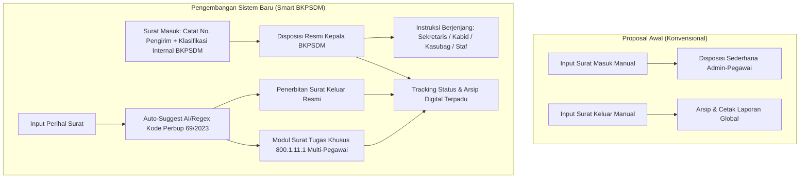
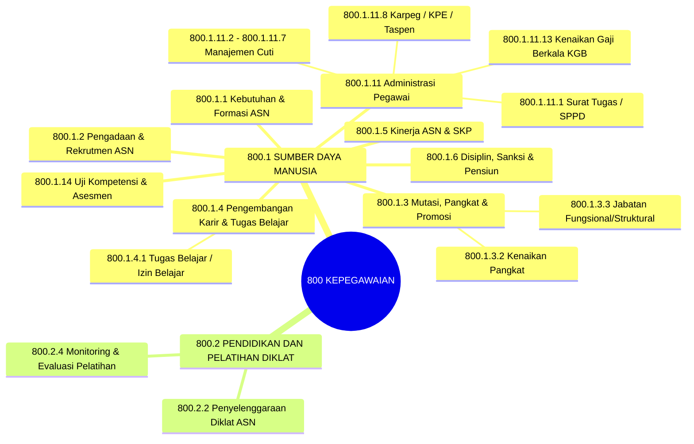
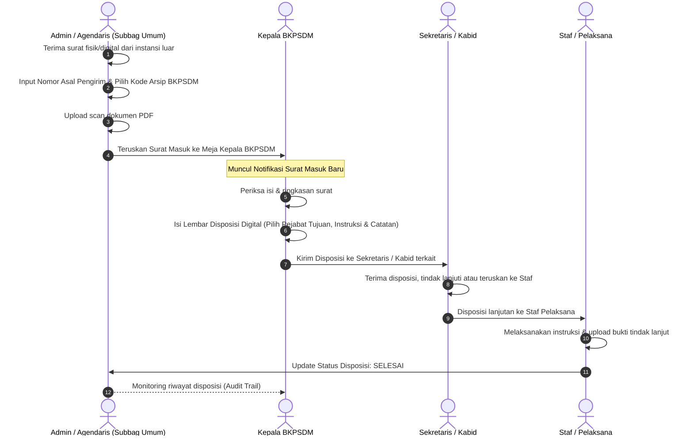
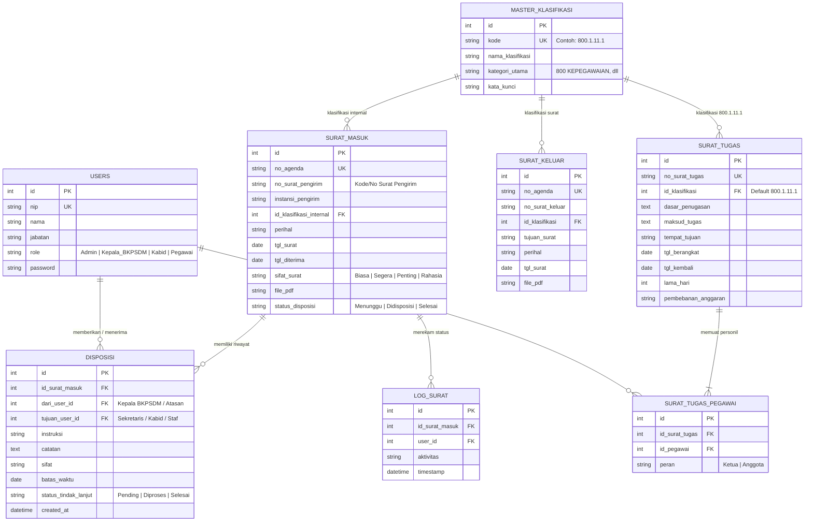

# Dokumen Analisis Sistem Informasi Persuratan Berbasis Web
## BKPSDM Kabupaten Luwu Timur

**Kajian Integrasi Proposal Skripsi & Peraturan Bupati Luwu Timur No. 69 Tahun 2023**

---

### Informasi Penelitian & Landasan Dokumen

| Parameter | Keterangan Dokumen Analisis |
| :--- | :--- |
| **Peneliti** | **Yusri Mahendra** (NIM: IK2311011) |
| **Program Studi** | Sarjana Informatika, Fakultas Ilmu Komputer, Universitas Mega Buana Palopo (2026) |
| **Pembimbing I** | Ir. JUSTAM, S.Kom., M.Kom. (NIDN: 0925078504) |
| **Judul Penelitian** | *Pengembangan Sistem Informasi Persuratan Berbasis Web pada BKPSDM Kabupaten Luwu Timur Menggunakan Metode Waterfall* |
| **Lokasi Penelitian** | Badan Kepegawaian dan Pengembangan Sumber Daya Manusia (BKPSDM) Kab. Luwu Timur |
| **Regulasi Rujukan** | **Peraturan Bupati Luwu Timur Nomor 69 Tahun 2023** tentang *Kode Klasifikasi Arsip di Lingkungan Pemerintah Daerah* (Permendagri No. 83/2022) |

---

## 1. Executive Summary & Telaah Kebutuhan Baru

Berdasarkan analisis menyeluruh terhadap **Proposal Skripsi** dan berkas **Perbup Luwu Timur No. 69 Tahun 2023**, terdapat peningkatan (enhancement) fungsional yang sangat signifikan dari cakupan awal proposal. Perubahan ini membuat sistem tidak hanya sekadar aplikasi pencatatan CRUD standar, melainkan sebuah **Sistem Tata Kelola Persuratan & Disposisi Pemerintahan Digital (Smart E-Office Persuratan)** yang spesifik untuk BKPSDM Kabupaten Luwu Timur.

Empat kebutuhan baru yang diminta memiliki urgensi administratif tinggi:
1. **Auto-Suggest Kode Klasifikasi Otomatis Berdasarkan Perihal Surat**: Menggunakan kecerdasan pencarian teks (string matching / tokenisasi) terhadap master data Perbup No. 69/2023 (terutama klaster `800 - KEPEGAWAIAN`), sehingga staf/admin tidak perlu menghafal atau mencari manual ribuan lembar buku klasifikasi.
2. **Modul Khusus Surat Tugas (SPT)**: Mengakomodir kode arsip `800.1.11.1` (*Surat Perintah Dinas/Surat Tugas*) dengan format multi-pegawai, dasar hukum penugasan, maksud kedinasan, tujuan lokasi, tanggal keberangkatan/kembali, pembebanan anggaran, serta cetak otomatis format SPT dinas.
3. **Dual Code Tracking pada Surat Masuk**: Surat dari instansi luar membawa nomor/kode klasifikasi pengirimnya sendiri, sedangkan BKPSDM memerlukan kode klasifikasi arsip internal berdasarkan Perbup Luwu Timur 2023 untuk penataan temu kembali berkas (*retrieval*).
4. **Alur Disposisi Formal Kepala BKPSDM**: Penerjemahan hierarki komando birokrasi pemerintahan daerah: Surat Masuk diterima Resepsionis/Admin Subbag Umum $\rightarrow$ Diteruskan ke **Kepala BKPSDM** $\rightarrow$ Diberi instruksi/catatan disposisi digital $\rightarrow$ Diteruskan ke Sekretaris / Kepala Bidang / Pejabat Terkait $\rightarrow$ Ditindaklanjuti pegawai $\rightarrow$ Laporan status *real-time*.

---

## 2. Gap Analysis: Proposal Awal vs Kebutuhan Baru

Berikut adalah perbandingan komparatif antara rumusan awal pada proposal skripsi dengan kebutuhan riil operasional saat ini:

| Komponen Fitur | Ruang Lingkup Proposal Awal | Rancangan Sistem Baru yang Disempurnakan | Nilai Tambah Akademis (Skripsi) |
| :--- | :--- | :--- | :--- |
| **Penentuan Kode Klasifikasi** | Manual (admin mengetik kode bebas tanpa validasi regulasi) | **Auto-Suggest Otomatis**: Saat admin mengetik perihal (misal: *"usulan kenaikan pangkat"*), sistem menampilkan rekomendasi kode Perbup (`800.1.3.2`) | Menjadi poin inovasi utama (*Smart Suggestion Engine*) yang sangat disukai penguji skripsi |
| **Kode Surat Masuk** | Hanya satu kolom nomor surat | **Dual-Identification**: Menyimpan Nomor & Kode Asal Instansi Pengirim sekaligus Kode Klasifikasi Penataan Arsip BKPSDM Luwu Timur | Menjaga integritas data korespondensi antar instansi pemerintah |
| **Disposisi Surat** | 1 arah (Admin ke Pegawai) | **Alur Pimpinan**: Admin $\rightarrow$ **Kepala BKPSDM** $\rightarrow$ Instruksi Disposisi $\rightarrow$ Pejabat Struktural (Sekretaris/Kabid) $\rightarrow$ Pelaksana | Sesuai SOP Tata Naskah Dinas Permendagri & Pemkab Luwu Timur |
| **Surat Tugas** | Digabung dalam surat keluar biasa tanpa struktur khusus | **Modul Khusus Surat Perintah Tugas (SPT)**: Form khusus penugasan personil (NIP, Pangkat, Jabatan), tujuan dinas, pembebanan anggaran, dan cetak SPT resmi | Menjawab kebutuhan operasional harian BKPSDM yang memiliki mobilitas kedinasan tinggi |
| **Aktor Pengguna** | 2 Aktor (Admin, Pegawai) | **4 Role**: (1) Admin/Agendaris, (2) Kepala BKPSDM, (3) Pejabat Struktural (Sekretaris/Kabid), (4) Pegawai/Staf Pelaksana | Hak akses dan matriks wewenang menjadi lebih presisi dan aman |

---

## 3. Analisis Regulasi: Peraturan Bupati Luwu Timur No. 69 Tahun 2023

Berdasarkan ekstraksi data dari `PERBUP Kode Klasifikasi Arsip 2023.pdf`, klasifikasi arsip di Pemerintah Kabupaten Luwu Timur mengadopsi kodifikasi desimal terstandar.

### 3.1 Klaster Utama Kode Klasifikasi:
- `000` : **UMUM** (Hukum, Organisasi, Ketatalaksanaan, Hubungan Masyarakat, dll.)
- `100` : **PEMERINTAHAN** (Otonomi, Pemerintahan Desa, dll.)
- `200` : **POLITIK**
- `300` : **KEAMANAN DAN KETERTIBAN**
- `400` : **KESEJAHTERAAN RAKYAT**
- `500` : **PEREKONOMIAN**
- `600` : **PEKERJAAN UMUM DAN KETENAGAAN**
- `700` : **PENGAWASAN** (Inspektorat)
- **`800`** : **KEPEGAWAIAN** *(Core Domain Utama BKPSDM)*
- `900` : **KEUANGAN**

### 3.2 Pemetaan Sub-Klasifikasi Kepegawaian (`800`) untuk BKPSDM:
Sistem akan memprioritaskan indexing dan pencarian pintar pada sub-klasifikasi berikut:

---

## 4. Mekanisme Algoritma Auto-Suggestion Kode Klasifikasi

Untuk menjawab kebutuhan *"semisal dikasi masuk perihalnya langsung muncul kode klasifikasinya"*, sistem menerapkan algoritma **Intelligent Keyword & N-Gram Matching** yang mencocokkan teks perihal surat dengan basis data klasifikasi Perbup Luwu Timur:

### Alur Kerja Algoritma:
1. **Input Perihal**: Pengguna mengetik kalimat perihal pada form, misalnya: *"Permohonan Cuti Tahunan Pegawai"* atau *"Usulan Kenaikan Pangkat Periode April"*.
2. **Preprocessing Teks (Text Normalization)**:
   - Case folding (menjadikan huruf kecil semua).
   - Stopwords removal (menghapus kata sambung umum seperti *dan, yang, untuk, di, dari*).
   - Tokenisasi (memecah perihal menjadi kata kunci penting: `cuti`, `tahunan`, `kenaikan`, `pangkat`).
3. **Pencarian Relevansi (Relevance Scoring)**:
   - Pencocokan kata kunci pada tabel `master_klasifikasi` (kolom `nama_klasifikasi` dan `kata_kunci`).
   - Prioritas bobot (Weighting): Klaster `800` (Kepegawaian) diberikan bobot kecocokan tertinggi karena beroperasi di lingkungan BKPSDM.
4. **Output Rekomendasi (Instant Suggestion Dropdown)**:
   - Menampilkan 3-5 opsi kode paling relevan secara *real-time* (debounce 300ms).
   - Pengguna cukup melakukan 1 kali klik pada saran yang muncul untuk otomatis mengisi *Field Kode Klasifikasi* dan *Nama Klasifikasi*.

> [!TIP]
> **Contoh Simulasi Nyata:**
> - Input: *"Perjalanan dinas monitoring evaluasi ke kecamatan"* $\rightarrow$ Sistem menyarankan: **`800.1.11.1` Surat Perintah Dinas/Surat Tugas**.
> - Input: *"Permohonan perpanjangan cuti melahirkan"* $\rightarrow$ Sistem menyarankan: **`800.1.11.3` Cuti Bersalin**.
> - Input: *"Pengantar berkas pensiun bup"* $\rightarrow$ Sistem menyarankan: **`800.1.6.6` Pensiun ASN**.

---

## 5. Struktur Alur Bisnis (Workflow) Disposisi Kepala BKPSDM

Alur disposisi diatur mengikuti tata kelola persuratan resmi di BKPSDM Kabupaten Luwu Timur:

### Elemen Lembar Disposisi Digital Kepala BKPSDM:
- **Sifat Disposisi**: *Sangat Segera*, *Segera*, *Biasa*, *Rahasia*.
- **Tujuan Disposisi (Pejabat Struktural BKPSDM Luwu Timur)**:
  - Sekretaris BKPSDM
  - Kepala Bidang Pengadaan, Mutasi dan Informasi Kepegawaian
  - Kepala Bidang Pengembangan Kompetensi dan Penilaian Kinerja Aparatur
  - Kepala Sub Bagian Umum dan Kepegawaian
  - Pejabat Fungsional / Staf Terkait
- **Pilihan Instruksi Standar (Checklist Cepat)**:
  - Tindak lanjuti / Selesaikan
  - Pelajari & berikan pertimbangan/telaahan
  - Siapkan konsep tanggapan/surat balasan
  - Hadiri / Wakili / Koordinasikan
  - Jadwalkan dalam agenda
  - Arsipkan / Untuk diketahui (UDK)
- **Catatan Pimpinan (Free Text Area)**: Catatan khusus arahan langsung Kepala BKPSDM.
- **Batas Waktu Penyelesaian (Deadline)**.

---

## 6. Modul Khusus: Surat Perintah Tugas (SPT)

Modul ini dibuat khusus untuk memfasilitasi kebutuhan penerbitan Surat Tugas kedinasan di BKPSDM Luwu Timur:

1. **Penomoran Otomatis**: Format penomoran surat tugas mengacu pada Perbup 69/2023:
   $$\text{Format: } \frac{800.1.11.1}{\text{No. Urut}}/\text{BKPSDM}/\text{Bulan Romawi}/\text{Tahun}$$
   *Contoh:* `800.1.11.1/045/BKPSDM/X/2026`
2. **Daftar Pegawai yang Ditugaskan (Multi-Personil)**:
   - Satu surat tugas dapat memuat lebih dari 1 personil (Ketua Tim & Anggota).
   - Mengambil data dari Master Pegawai (Nama, NIP, Pangkat/Golongan, Jabatan).
3. **Detail Penugasan**:
   - **Dasar Surat**: Surat undangan masuk, telaah staf, atau program kerja tahunan.
   - **Maksud Penugasan**: Rincian kegiatan dinas.
   - **Lokasi & Tujuan**: Tempat pelaksanaan tugas (Lokal Kab. Luwu Timur, Luar Daerah, atau Luar Provinsi).
   - **Waktu Pelaksanaan**: Tanggal berangkat, tanggal kembali, lama penugasan (jumlah hari).
   - **Pembebanan Anggaran**: DPA-SKPD BKPSDM Kabupaten Luwu Timur Tahun Anggaran berjalan.
4. **Fitur Ekspor / Cetak**: Cetak langsung ke format resmi PDF berkop surat Pemkab Luwu Timur dan BKPSDM siap tanda tangan / e-sign.

---

## 7. Perancangan Basis Data (Entity Relationship Diagram)

Untuk mendukung semua fungsionalitas di atas, dirancang 8 entitas tabel relasional:

---

## 8. Penyesuaian Bab Metodologi Penelitian (Waterfall Model)

Bagi penelitian skripsi saudara Yusri Mahendra, pengembangan sistem ini mengikuti siklus **Waterfall (Presman / Rosa & Shalahuddin)**:

1. **Analisis Kebutuhan (Requirements Analysis)**:
   - Mengkaji format surat masuk, surat keluar, disposisi dan surat tugas di BKPSDM Luwu Timur.
   - Mengintegrasikan kodifikasi Perbup Luwu Timur No. 69 Tahun 2023 ke dalam kamus sistem.
2. **Perancangan Sistem (System Design)**:
   - Desain UML: Flowchart, Use Case Diagram, Activity Diagram, Sequence Diagram.
   - Perancangan Basis Data (ERD dan Konseptual Data Model).
   - Perancangan Antarmuka (UI/UX) berbasis web yang modern, interaktif, responsif, dan mudah dipahami pimpinan/pegawai.
3. **Pengkodean / Implementasi (Coding)**:
   - Membangun antarmuka web responsif dan modul fungsional:
     - Form Auto-Suggest Klasifikasi Perbup.
     - Form Dual Code Surat Masuk (Nomor Pengirim + Kode Arsip BKPSDM).
     - Dashboard & Lembar Disposisi Interaktif Kepala BKPSDM.
     - Generator Form & Cetak Surat Tugas Multi-Pegawai.
     - Manajemen Arsip & Cetak Buku Agenda Laporan.
4. **Pengujian (Testing)**:
   - Uji fungsionalitas menggunakan metode **Black Box Testing** mencakup skenario input perihal, keakuratan auto-suggest kode klasifikasi, alur disposisi antar akun pimpinan dan bawahan, validasi upload berkas surat, serta ekspor laporan.
5. **Pemeliharaan (Maintenance)**:
   - Penataan backup basis data dan pembaruan berkala jika ada revisi peraturan klasifikasi arsip daerah.

---

## 9. Kesimpulan & Rekomendasi Langkah Konkret

1. **Kelayakan Skripsi**: Penambahan 4 fitur ini (**Auto-Suggest Perbup 69/2023, Modul Surat Tugas, Dual Code Surat Masuk, dan Disposisi Kepala BKPSDM**) membuat skripsi ini memiliki **kebaruan (*novelty*) dan nilai guna praktis yang sangat kuat**, melampaui aplikasi persuratan biasa yang sering diuji di kampus.
2. **Kesiapan Data Master**: Seluruh master data kode klasifikasi dari Perbup Luwu Timur No. 69 Tahun 2023 telah berhasil diekstraksi dan siap dijadikan basis data auto-suggest sistem.
3. **Rencana Implementasi**: Siap dilanjutkan ke perancangan antarmuka visual (UI/UX Mockup) dan pembangunan prototipe web aplikasi lengkap.
